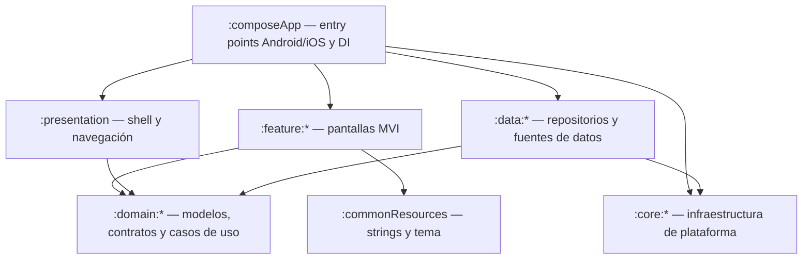

# PhysioApp

[English](README.md) · **Español**

Aplicación **offline-first** para fisioterapeutas y clínicas de fisioterapia que permitirá gestionar profesionales, pacientes, informes clínicos y facturas desde **iPad y tabletas Android**, guardando toda la información en una base de datos local del dispositivo.

> **Estado del proyecto: pre-alfa.**
> Están hechas las fases 0–10 del plan: renombrado a PhysioApp (`com.connectapp.physioapp`), limpieza de la plantilla de partida (*CleanArch*), persistencia local cifrada, **autenticación local** (registro, código de recuperación, login, ficha profesional obligatoria y bloqueo por inactividad), el **shell para tableta** (Home adaptable con las ocho secciones), las **fichas de profesionales** (alta, búsqueda, edición y archivado) las **fichas de pacientes** con su consentimiento firmado para el tratamiento de datos, los **informes clínicos** (con historial de ediciones y anulación) y los **justificantes de pago**, con **exportación a PDF** de justificantes e informes, y la fase de **endurecimiento** (cambio de contraseña y regeneración del código de recuperación en Ajustes, revisión de accesibilidad, pruebas de interfaz en las dos plataformas, auditoría de privacidad e inventario de licencias de terceros) y, a petición del propietario, la pantalla de licencias, las **copias de seguridad cifradas**, restaurables en otra tableta, y el **contenido oculto en capturas y en el selector de apps**. El desarrollo está terminado; queda la prueba manual en tabletas reales y los pasos de [Limitaciones y hoja de ruta](#limitaciones-y-hoja-de-ruta) para quien la implante en una clínica. **Los justificantes son internos: no son facturas fiscales.** El plan completo está en [`docs/00-auditoria-y-plan.md`](docs/00-auditoria-y-plan.md).

## Índice

1. [Público objetivo y alcance](#público-objetivo-y-alcance)
2. [Características](#características)
3. [Plataformas](#plataformas)
4. [Filosofía offline y privacidad](#filosofía-offline-y-privacidad)
5. [Stack tecnológico](#stack-tecnológico)
6. [Arquitectura](#arquitectura)
7. [Modelo de datos](#modelo-de-datos)
8. [Instalación y puesta en marcha](#instalación-y-puesta-en-marcha)
9. [Uso funcional](#uso-funcional)
10. [Pruebas y calidad](#pruebas-y-calidad)
11. [Seguridad](#seguridad)
12. [Limitaciones y hoja de ruta](#limitaciones-y-hoja-de-ruta)
13. [Contribución](#contribución)
14. [Licencia y atribuciones](#licencia-y-atribuciones)
15. [Mantenimiento](#mantenimiento)

## Público objetivo y alcance

- **Usuarios:** fisioterapeutas y personal de clínicas de fisioterapia que trabajan con tableta.
- **Alcance:** autenticación local, fichas de pacientes y profesionales, informes clínicos y justificantes de pago con exportación a PDF, todo sin conexión a Internet ni servidores.

## Características

| Funcionalidad | Estado |
|---|---|
| Registro e inicio de sesión locales (contraseñas con hash y sal) | Implementado (fase 4) |
| Recuperación de contraseña offline | Implementada: código de recuperación de un solo uso que se muestra al registrarse; se restablece con email + código |
| Ficha del profesional conectado obligatoria tras el primer login (NIF/NIE, nº de colegiado) | Implementado (fase 4) |
| Bloqueo por inactividad y bloqueo del login | Implementados con los valores confirmados (decisión D14): 5 min; 5 fallos → 5 min; "Recordar sesión" desactivado por defecto |
| Home con accesos a pacientes, profesionales, informes y facturas | Implementado (fase 5): 8 tarjetas en una rejilla adaptable; desde la fase 9 todas las secciones tienen sus pantallas |
| Pacientes: alta con firma manuscrita, búsqueda por un criterio, edición, borrado | Implementado (fase 7): documento NIF/NIE, pasaporte u otro; el paciente (o su representante legal) firma en el alta el consentimiento para el tratamiento de datos, se conserva el historial de firmas y se puede volver a firmar; búsqueda por documento, nombre y apellidos o email; archivar/desarchivar; eliminación definitiva solo sin informes ni facturas. **El texto del consentimiento es provisional, pendiente de revisión jurídica** |
| Profesionales: alta, búsqueda, edición, borrado | Implementado (fase 6): colegio profesional de una lista cerrada con los 17 autonómicos, búsqueda por un criterio, edición, archivar/desarchivar y eliminación definitiva solo sin cuenta, informes ni facturas |
| Informes clínicos: código único, autocompletado de paciente, búsqueda y detalle | Implementado (fase 8): código único aleatorio `INF-XXXXXXXX`; autor = profesional de la sesión; selector de paciente con sugerencias (solo pacientes activos); búsqueda por nº de informe, nombre o documento del paciente; solo el autor puede editar (se conservan y se pueden consultar las versiones anteriores) o anular con motivo; los informes nunca se borran; cualquier profesional puede exportar la versión vigente a PDF (fase 9) |
| Facturas: creación, indicador de pago, búsqueda, exportación PDF | Implementado (fase 9) como **justificante de pago interno, no factura fiscal** (decisión D6): número correlativo sin huecos por año (`2026-000001`); autor = profesional de la sesión; datos del emisor y del paciente copiados al emitirlo; concepto, importe exacto, pagado y forma de pago opcional; "Guardar" y "Guardar y exportar PDF"; búsqueda por número, nombre o documento del paciente; solo el autor puede marcarlo como pagado/pendiente o anularlo con motivo (conserva su número); nunca se borran. Pantalla y PDF dicen "Este documento no es una factura" y llevan la mención de exención de IVA |
| Perfil del profesional conectado | Solo lectura (cuenta y ficha profesional); edición pendiente |
| Ajustes | Implementado (decisión D15): cabecera con el usuario, **Cambiar contraseña** (contraseña actual + la nueva), **Regenerar código de recuperación** (pide la contraseña, muestra el código nuevo una sola vez y el anterior deja de valer), "Acerca de" (versión), **Licencias de código abierto** (el software de terceros incluido y el texto completo de cada licencia, sin conexión), **Copias de seguridad** (crear y restaurar, con la fecha de la última) y "Cerrar sesión". Sin preferencias |
| Copias de seguridad cifradas | Implementado (plan §21.7, 2026-10-21): Ajustes → **Crear copia de seguridad** escribe toda la base de datos en un fichero cifrado con una contraseña que se elige en ese momento y abre el selector "guardar en" del sistema; **Restaurar copia de seguridad** sustituye todos los datos de la tableta tras pedir la contraseña de la copia, tu contraseña de acceso y una confirmación. En una tableta sin cuentas (nueva o reinstalada), la pantalla de inicio de sesión ofrece restaurar. Inicio avisa si nunca se ha hecho una copia o si la última tiene 7 días |

Las funciones heredadas de la plantilla que no forman parte de PhysioApp (pedidos de ejemplo, login contra backend, analítica Sentry, notificaciones, preferencias de Ajustes, edición de perfil y política de privacidad de ejemplo) **se retiraron en la fase 2**.

## Plataformas

- **Solo tabletas**: **iPad** (la app de iOS no se instala en iPhone) y **tabletas Android** (la app declara solo pantallas grandes y extragrandes, así que Google Play no la ofrece en móviles).
- Vertical y horizontal. El diseño se adapta al ancho de la ventana, también en Split View de iPad y en multiventana de Android.
- Valores actuales del proyecto (heredados de la plantilla, pendientes de revisión): Android `minSdk 26` / `targetSdk 36`; iOS `IPHONEOS_DEPLOYMENT_TARGET 18.2`.
- Requisitos de dispositivo concretos: *pendiente de verificar*.

## Filosofía offline y privacidad

- Los datos se guardan **solo en el dispositivo**, en una base de datos SQLite local (SQLDelight) cifrada con SQLCipher. La clave se guarda en Android Keystore / iOS Keychain y nunca sale del dispositivo.
- **Modelo de clínica compartida:** un dispositivo puede tener varias cuentas, y cada profesional ve todos los pacientes que hay en él. Cada informe y justificante registra su autor, y solo el autor puede modificarlo o anularlo. La clínica debe documentar este acceso compartido como parte de su tratamiento de datos.
- **No se borra nada clínico:** borrar un paciente o profesional lo archiva (se puede desarchivar), el borrado físico solo se permite si no tiene informes ni justificantes, y los justificantes se anulan en lugar de borrarse, conservando su número. Así se conserva la historia clínica que exige la Ley 41/2002 (mínimo 5 años).
- La app **no usa backend, servicios cloud, analítica ni telemetría**.
- PhysioApp trata **datos de salud** (categoría especial del RGPD). Guardar los datos en local **no elimina** las obligaciones legales de quien usa la app (responsable del tratamiento): base jurídica, conservación de la historia clínica, seguridad del dispositivo y copias de seguridad. La app no sustituye la revisión jurídica.

## Stack tecnológico

Versiones tomadas de [`gradle/libs.versions.toml`](gradle/libs.versions.toml) y de [`gradle/wrapper/gradle-wrapper.properties`](gradle/wrapper/gradle-wrapper.properties):

| Área | Tecnología | Versión |
|---|---|---|
| Lenguaje | Kotlin Multiplatform | 2.3.21 |
| Build | Gradle / Android Gradle Plugin | 9.3.1 / 9.1.0 |
| JDK del daemon de Gradle | JetBrains (toolchain) | 21 |
| UI | Compose Multiplatform + Material 3 | 1.11.0 / 1.10.0-alpha05 |
| Navegación | Navigation3 | 1.1.1 |
| Presentación | MVI (módulo `:core:mvi`) | — |
| Inyección de dependencias | Koin | 4.2.1 |
| Persistencia | SQLDelight | 2.3.2 |
| Cifrado de la base de datos | SQLCipher Community (Android: `net.zetetic:sqlcipher-android`; iOS: paquete Swift `SQLCipher.swift`) | 4.17.0 |
| Criptografía | `:core:crypto` sobre las APIs del sistema (JCA en Android, CommonCrypto/Security en iOS) | — |
| Almacenamiento seguro | KVault (Keystore / Keychain) | 1.12.0 |
| Análisis estático / cobertura | detekt / Kover | 1.23.8 / 0.9.9 |
| Pruebas de interfaz (solo tests) | Compose UI Test; Robolectric en el host de Android | 1.11.0; 4.17 |

La app no incluye ningún cliente HTTP ni SDK de analítica o telemetría: Ktor y Sentry, heredados de la plantilla, se eliminaron en la fase 2. El APK de Android no declara el permiso `INTERNET`.

## Arquitectura

Clean Architecture multimódulo con MVI. Las dependencias permitidas entre capas se **comprueban al compilar** con la tarea `verifyModuleBoundaries` (reglas en [`build-logic/src/main/kotlin/physioapp/convention/ModuleBoundaries.kt`](build-logic/src/main/kotlin/physioapp/convention/ModuleBoundaries.kt)).



| Carpeta | Contenido actual |
|---|---|
| `composeApp/` | `MainActivity` (Android), `MainViewController` (iOS), composición de módulos Koin, proveedor de la frase de paso de la base de datos |
| `presentation/` | `MainScreen`, barras superior/inferior, rutas y pila de navegación, bloqueo por inactividad |
| `feature/` | `splash`, `login`, `register`, `onboarding`, `forgot_password`, `home`, `profile`, `settings`, `professionals`, `patients`, `reports`, `invoices`, `backup` |
| `domain/` | `auth` (cuenta, ficha profesional, políticas de sesión y de bloqueo, casos de uso), `settings` (solo `AppVersionProvider`), `professionals`, `patients`, `reports` e `invoices` (fichas, validación, casos de uso; versión del consentimiento), `backup` (contrato de copias, regla de la contraseña, aviso a los 7 días), `shared` (validadores de nombre, email, teléfono, contraseña, NIF/NIE, documento de identidad y nº de colegiado; códigos de informe; catálogo de los 17 colegios profesionales; `Money` en céntimos; `RecoveryCode`; `SearchText`; la opción de paciente de los selectores) |
| `data/` | `auth` (repositorio sobre `PhysioDatabase`; sesión en un almacén KVault ligado al dispositivo), `professionals`, `patients`, `reports` e `invoices` (repositorios sobre `PhysioDatabase`; numeración de justificantes sin huecos), `backup` (copias a través de `:core:database`; fecha de la última en un almacén KVault ligado al dispositivo) |
| `core/` | `database` (`PhysioDatabase` cifrada con SQLCipher), `crypto` (PBKDF2, aleatorio seguro), `storage` (KVault), `mvi`, `pdf` (generador de PDF sin conexión en Kotlin común, sin librerías), `uitest` (solo para tests: base común y utilidades de las pruebas de interfaz Compose) |
| `commonResources/` | Textos compartidos (inglés/español), tema Material 3 derivado del logo, clases de ancho de ventana, `ListDetailLayout`, `EmptyState`, `ValidatedTextField`, `SelectField`, `SignaturePad` (con exportación a PNG), `RecoveryCodePanel`, `PatientPicker`, `ErrorMessage`, `LoadingIndicator`, aviso de cambios sin guardar, formato de fechas, compartir/guardar PDF en cada plataforma con su aviso |
| `build-logic/` | Convention plugins de Gradle (`physioapp.kmp.base`, `physioapp.kmp.compose`, `physioapp.module-boundaries`) |
| `iosApp/` | Proyecto Xcode contenedor |
| `docs/` | Plan, decisiones, procedencia e inventario de licencias de terceros |

La arquitectura está descrita en el [plan, §5](docs/00-auditoria-y-plan.md#5-arquitectura-propuesta-coherente-con-la-plantilla).

## Modelo de datos

El esquema **v1** está en [`core/database/src/commonMain/sqldelight/`](core/database/src/commonMain/sqldelight/): tablas `account`, `professional`, `patient`, `patient_signature`, `clinical_report`, `clinical_report_version`, `invoice_series` e `invoice`. Usa claves de texto (UUID), claves foráneas activas en cada conexión, borrado lógico (`archived_at`) con `ON DELETE RESTRICT` para lo referenciado, numeración de justificantes correlativa y sin huecos por serie anual e importes en céntimos. La instantánea [`1.db`](core/database/src/commonMain/sqldelight/databases/) permite verificar futuras migraciones (`./gradlew verifySqlDelightMigration`).

La autenticación ya usa `account` y `professional`: cada cuenta está vinculada 1:1 con su ficha profesional, que se crea en el paso de onboarding o se enlaza con una existente que tenga el mismo NIF, colegio y nº de colegiado. El nº de colegiado es único dentro de su colegio, porque cada colegio numera a sus miembros por su cuenta. La caché de perfil sin cifrar heredada de la plantilla (`AuthDatabase`) se retiró en la fase 4. El justificante no es una factura fiscal (D6); guarda los datos de emisor y destinatario y el tratamiento del IVA para poder evolucionar a factura. Mientras no haya ninguna versión distribuida, la v1 se puede modificar sin migración ([plan, §6](docs/00-auditoria-y-plan.md#6-modelo-de-datos-propuesta)).

## Instalación y puesta en marcha

### Prerrequisitos

- Android Studio con el plugin Kotlin Multiplatform.
- Xcode (para iPadOS) — versión mínima *pendiente de verificar*.
- Gradle descarga automáticamente el JDK 21 que necesita su daemon.
- La primera compilación de iOS necesita conexión: Xcode descarga el paquete Swift `SQLCipher.swift` 4.17.0, fijado en `iosApp/iosApp.xcodeproj/project.xcworkspace/xcshareddata/swiftpm/Package.resolved`.

### Clonado

Repositorio: <https://github.com/ManuelAf-ConnectApp/PhysioApp>

```bash
git clone https://github.com/ManuelAf-ConnectApp/PhysioApp.git
cd PhysioApp
```

### Configuración

No hace falta ninguna configuración: no hay URLs de backend, claves de API ni DSN de telemetría. La versión visible en Ajustes sale de `-PreleaseVersionName` (por defecto `1.0`).

### Compilar y ejecutar

**Android** (verificado el 2026-10-20):

```sh
./gradlew :composeApp:assembleDebug
```

También puedes usar la configuración de ejecución `composeApp` de Android Studio con una tableta o un emulador de tableta.

**iPadOS**: abre `iosApp/iosApp.xcodeproj` en Xcode y ejecuta el esquema `iosApp` en un simulador de iPad (Mac con Apple Silicon: el proyecto solo genera el target `iosSimulatorArm64`). Compilación desde terminal, verificada el 2026-10-20:

```sh
xcodebuild -project iosApp/iosApp.xcodeproj -scheme iosApp -sdk iphonesimulator \
  -destination "generic/platform=iOS Simulator" ARCHS=arm64 CODE_SIGNING_ALLOWED=NO build
```

Para comprobar solo el código Kotlin/Native (verificado el 2026-10-20):

```sh
./gradlew linkDebugFrameworkIosSimulatorArm64
```

## Uso funcional

Flujos actuales (autenticación, profesionales, pacientes, informes, justificantes y copias de seguridad):

1. **Registro**: nombre, apellidos (no vacíos), email y contraseña. Cada campo muestra su error al salir de él y el botón sigue deshabilitado hasta que todo es válido. La contraseña necesita al menos 12 caracteres con mayúscula, minúscula, dígito y símbolo.
2. **Código de recuperación**: se muestra **una sola vez** tras el registro (`XXXXX-XXXXX-XXXXX-XXXXX`). Apúntalo y confirma que lo has guardado: es la única forma de restablecer la contraseña. Registrarse no inicia sesión.
3. **Inicio de sesión**: una contraseña errónea y un email desconocido dan el mismo mensaje. Tras 5 fallos seguidos, el login se bloquea 5 minutos.
4. **Onboarding**: en el primer inicio de sesión se completa la ficha profesional (NIF/NIE, colegio profesional y nº de colegiado tal como aparece en la acreditación; nombre y apellidos vienen precargados).
5. **Home**, con la barra inferior **Inicio · Perfil · Ajustes** y ocho tarjetas: registrar y buscar pacientes, profesionales, informes y justificantes. En una tableta en horizontal las tarjetas se muestran en dos filas de cuatro; en vertical, en la mayoría de tabletas, en cuatro filas de dos. Cada tarjeta abre su sección con flecha atrás en la barra superior. Perfil muestra la cuenta y la ficha; Ajustes permite cambiar la contraseña, regenerar el código de recuperación, ver la versión y las licencias de código abierto, y cerrar sesión.
6. **Recuperar contraseña**: email + código de recuperación + contraseña nueva. Se genera un código de recuperación nuevo y el anterior deja de valer.
7. Tras **5 minutos de inactividad** se cierra la sesión, también si se reinicia la app.
8. **Registrar profesional**: NIF/NIE, colegio, nº de colegiado, nombre y apellidos son obligatorios; email, teléfono, dirección y notas son opcionales. Al guardar se abre la ficha nueva.
9. **Buscar profesional**: se elige un criterio (NIF/NIE, nombre y apellidos o nº de colegiado) y se escribe; no distingue tildes ni mayúsculas. "Mostrar archivados" añade las fichas archivadas. En horizontal la ficha se abre junto a la lista; en vertical, como pantalla propia. Desde la ficha se puede **editar**, **archivar** (desaparece de las búsquedas y se puede desarchivar) o, si no tiene cuenta, informes ni justificantes, **eliminar definitivamente**. Archivar y eliminar piden confirmación.
10. **Registrar paciente**: documento (NIF/NIE, pasaporte u otro documento, por ejemplo el del tutor de un menor), nombre y apellidos son obligatorios; email, teléfono, dirección y notas son opcionales. Debajo aparecen el texto del consentimiento (marcado como provisional) y la superficie de firma: se elige quién firma (el paciente o un representante legal, cuyo nombre y documento pasan a ser obligatorios), se firma con el dedo o con un lápiz y "Limpiar" permite repetir. Guardar está desactivado hasta que hay firma.
11. **Buscar paciente**: por documento, nombre y apellidos o email, igual que con profesionales. La ficha muestra la última firma, quién firmó, cuándo y la versión del texto. **Volver a firmar** añade una firma nueva y conserva las anteriores. Editar los datos no obliga a volver a firmar.
12. **Cambios sin guardar**: salir de un formulario con cambios (flecha atrás, gesto del sistema o barra inferior) pregunta si se quieren descartar.
13. **Crear informe**: el profesional es el de la sesión y no se puede cambiar; al escribir en "Paciente" aparecen sugerencias (solo pacientes activos) y se elige uno; se rellenan los datos del informe y la dolencia. Al guardar se abre el informe con su código (`INF-…`).
14. **Buscar informe**: por nº de informe, nombre o documento del paciente; los más recientes primero y los anulados marcados. El informe muestra sus fechas, el paciente y el autor. Solo el autor ve **Editar** (cada edición conserva el texto anterior, consultable en "Ver versiones anteriores") y **Anular** (pide un motivo; el informe sigue visible como anulado). Los informes nunca se borran. **Exportar PDF** está disponible para cualquier profesional.
15. **Crear justificante**: un aviso indica que no es una factura; el profesional es el de la sesión; el paciente se elige entre las sugerencias; el concepto empieza como "Sesión de fisioterapia"; se escribe el importe (`45`, `45,5` o `45.50`) y se marca "Pagado" para elegir, si se quiere, la forma de pago. **Guardar** abre el justificante con su número (`2026-000001`); **Guardar y exportar PDF** lo abre con el diálogo de exportación.
16. **Buscar justificante**: por número, nombre o documento del paciente; los anulados salen marcados y se ve si está pagado o pendiente. Cualquiera puede **Exportar PDF**; solo el autor puede **Marcar como pagado**/**Marcar como pendiente** o **Anular** (pide un motivo). Los justificantes no se editan ni se borran: para corregir uno se anula y se emite otro.
17. **Cambiar contraseña** (Ajustes): escribe la contraseña actual y dos veces la nueva. La sesión sigue abierta. Cinco contraseñas actuales erróneas cuentan como inicios de sesión fallidos: la cuenta se bloquea 5 minutos y la sesión se cierra.
18. **Regenerar código de recuperación** (Ajustes): escribe tu contraseña; el código nuevo se muestra una vez y el anterior deja de funcionar. "Volver a Ajustes" se activa al confirmar que lo has guardado.
19. **Licencias de código abierto** (Ajustes): el software de terceros de la app agrupado por licencia, con sus titulares; toca una licencia para leer su texto completo.
20. **Exportar PDF** (justificantes e informes): un aviso indica que el PDF contiene datos personales y de salud y sale de la protección de la app; después, **Compartir** (hoja de compartir del sistema) o **Guardar en…** (elegir carpeta o app). La copia temporal se borra después (en Android, antes de la siguiente exportación o al abrir la app).
21. **Crear copia de seguridad** (Ajustes, o "Hacer copia" en el aviso de Inicio): escribe dos veces una contraseña para la copia (con las mismas reglas que las de las cuentas) y elige dónde guardar el fichero (`physioapp-copia-<fecha>-<hora>.physiobackup`), mejor fuera de la tableta. Apunta la contraseña y guárdala separada del fichero: no se guarda en ningún sitio y no se puede recuperar. Solo cuenta como última copia cuando el fichero se ha guardado.
22. **Restaurar copia de seguridad** (Ajustes): elige el fichero, escribe su contraseña y tu contraseña de acceso, y confirma. Todos los datos de la tableta se sustituyen por los de la copia (cuentas incluidas), la sesión se cierra y se entra con una cuenta de la copia. En una tableta nueva o reinstalada, usa **"¿Tableta nueva? Restaurar una copia de seguridad"** en la pantalla de inicio de sesión, que solo pide la contraseña de la copia.

## Pruebas y calidad

| Comando | Qué hace | Estado |
|---|---|---|
| `./gradlew testAndroidHostTest testDebugUnitTest` | Tests unitarios, de esquema, de repositorio y **de interfaz** de todos los módulos en la JVM (los de interfaz con Robolectric, como tableta en horizontal) | Verificado 2026-10-21 (tras las copias de seguridad): 371 tests, 0 fallos, 37 de ellos de interfaz |
| `./gradlew iosSimulatorArm64Test` | Tests de los módulos compartidos en el simulador de iOS, incluido el cifrado real (enlazando el `SQLCipher.xcframework` oficial, verificado por checksum) y las mismas pruebas de interfaz | Verificado 2026-10-21: 308 tests, 0 fallos, 37 de ellos de interfaz; las copias se crean y restauran con el SQLCipher real |
| `./gradlew :core:database:connectedAndroidDeviceTest` | Cifrado en disco en un dispositivo o emulador Android conectado | Verificado 2026-10-16 (emulador API 37): 7 tests, 0 fallos |
| `./gradlew verifySqlDelightMigration` | Coherencia del esquema con sus migraciones | Verificado 2026-10-21 |
| `./gradlew build` | Compilación, lint de Android, tests y verificación de dependencias entre módulos | Lo ejecuta la CI (`:composeApp:lintDebug` y `verifyModuleBoundaries` verificados en local el 2026-10-21) |
| `./gradlew detekt` y `./gradlew -p build-logic detekt` | Análisis estático | Verificado 2026-10-21: sin hallazgos fuera de las baselines existentes |
| `./gradlew koverHtmlReport` | Informe de cobertura agregado en `build/reports/kover/html` | Lo ejecuta la CI |

Las **pruebas de interfaz** están en el `commonTest` de cada módulo (clases que terminan en `UiTest`) y se ejecutan sin cambios en las dos plataformas: heredan de `UiTest` de `:core:uitest` y usan los módulos Koin reales de la feature con repositorios falsos. Cubren el login (válido, inválido, recordar sesión), la validación del registro y el código de recuperación, la recuperación de contraseña, Ajustes, el alta de paciente con firma dibujada, la búsqueda excluyente con archivados y la vista lista-detalle en los dos anchos, el borrado y el archivado con confirmación, la creación de informes con sugerencias de paciente y las acciones reservadas al autor, los justificantes (validación, indicador de cobro, aviso del PDF) el shell (cabecera, diálogo de cambios sin guardar) la pantalla de licencias (se abre el texto de cada licencia incluida), las copias de seguridad (reglas de la contraseña, restauración con confirmación, con o sin sesión) y la opción de restaurar en el inicio de sesión de una tableta sin cuentas.

**Accesibilidad** (revisada en la fase 10): todos los botones de icono tienen descripción y los iconos decorativos no; las filas seleccionables anuncian si están seleccionadas; los títulos de sección son cabeceras; los errores y el indicador de carga se anuncian; los botones crecen con el tamaño de letra del sistema; y todas las parejas texto/fondo cumplen WCAG AA (≥ 4,5:1) en tema claro y oscuro. El panel de firma tiene descripción pero necesita entrada táctil: un paciente que no pueda firmar puede hacerlo a través de un representante legal (D13). Falta comprobarlo con TalkBack y VoiceOver en un dispositivo.

**Pruebas manuales:** el flujo de autenticación se comprobó en un emulador Android con la base de datos cifrada real (2026-10-19). Queda pendiente todo el flujo en iPad, la caducidad real por inactividad en ambas plataformas, el aspecto final de los iconos en el lanzador y el shell para tableta de la fase 5 (rejilla de la Home y navegación en vertical y horizontal en una tableta Android y en un iPad, también en Split View) las pantallas de profesionales de la fase 6 ([plan, §17.3](docs/00-auditoria-y-plan.md#173-pendiente-de-prueba-manual-propietario)) y las de pacientes de la fase 7, incluida la imagen de la firma en las dos plataformas ([plan, §18.3](docs/00-auditoria-y-plan.md#183-pendiente-de-prueba-manual-propietario)), las de informes de la fase 8 ([plan, §19.3](docs/00-auditoria-y-plan.md#193-pendiente-de-prueba-manual-propietario)) los justificantes y el compartir/guardar PDF de la fase 9 en las dos plataformas ([plan, §20.3](docs/00-auditoria-y-plan.md#203-pendiente-de-prueba-manual-propietario)) las pantallas de Ajustes y la pasada con lector de pantalla de la fase 10 ([plan, §21.4](docs/00-auditoria-y-plan.md#214-pendiente-de-prueba-manual-propietario)) y las copias de seguridad: guardar, elegir el fichero y restaurar en otra tableta, en las dos plataformas ([plan, §21.7](docs/00-auditoria-y-plan.md#217-ampliación-copias-de-seguridad-cifradas-2026-10-21)). La prueba de copias en Android (`PhysioDatabaseBackupTest`) se ejecuta con `./gradlew :core:database:connectedAndroidDeviceTest` en un dispositivo o emulador.

La integración continua está en [`.github/workflows/ci.yml`](.github/workflows/ci.yml) (heredada de la plantilla, con los identificadores de PhysioApp).

## Seguridad

| Medida | Estado |
|---|---|
| Contraseñas con KDF robusta y sal individual | Implementado (`:core:crypto`): PBKDF2-HMAC-SHA256, 600 000 iteraciones, sal aleatoria de 16 bytes, normalización Unicode NFC y comparación en tiempo constante; nuevo hash automático si cambian los parámetros. Política: mínimo 12 caracteres con mayúscula, minúscula, dígito y símbolo |
| Recuperación de contraseña offline | Implementado: código de un solo uso de 100 bits, guardado solo como hash PBKDF2, que se muestra una vez y nunca se copia al portapapeles; al restablecer se genera uno nuevo, y desde Ajustes se puede regenerar tras pedir la contraseña |
| Cambio de contraseña | Implementado (Ajustes): exige la contraseña actual; los intentos erróneos comparten el contador de bloqueo del login y, al llegar al bloqueo, la sesión también se cierra |
| Protección frente a enumeración y fuerza bruta | Implementado: los emails desconocidos reciben el mismo mensaje y el mismo coste de verificación; bloqueo tras 5 fallos durante 5 minutos |
| Base de datos cifrada | Implementado: SQLCipher 4.17.0 con frase de paso aleatoria de 256 bits guardada en Keystore/Keychain (en iOS, `WhenUnlockedThisDeviceOnly`). La app **se niega a abrir** la base si el runtime no es SQLCipher. Verificado en un emulador Android y en el simulador de iOS: sin texto en claro en disco y sin poder abrirla con otra clave |
| Secretos en Keystore / Keychain | Implementado (KVault). La sesión guarda solo el id de la cuenta y la última actividad, en un almacén ligado al dispositivo |
| Bloqueo por inactividad | Implementado: 5 minutos, también entre reinicios |
| Copias de seguridad automáticas del SO desactivadas | Implementado. Android: `allowBackup="false"` y `data_extraction_rules.xml`, que excluye también la transferencia entre dispositivos. iOS: la carpeta de la base está excluida de las copias de iCloud y del ordenador, y sus ficheros usan `NSFileProtectionCompleteUnlessOpen` (ilegibles con el iPad bloqueado); la clave nunca sale del dispositivo (`ThisDeviceOnly`). Una copia del sistema tampoco podría descifrarse en otro dispositivo; para eso están las copias cifradas de la app (fila siguiente) |
| Copias de seguridad de la app | Implementado (plan §21.7): fichero SQLCipher cifrado con su propia contraseña (PBKDF2-HMAC-SHA512, 256 000 iteraciones, sal aleatoria, páginas autenticadas), nunca con la clave del dispositivo; la contraseña sigue la política de las cuentas y no se guarda. El fichero se escribe en la carpeta temporal privada de la app y se borra al entregarlo al selector "guardar en"; su nombre solo lleva la fecha. Al restaurar se comprueba la contraseña y que el fichero sea una copia de PhysioApp de la misma versión de base de datos, y se sustituyen todas las filas en una sola transacción (si falla, no cambia nada). Desde Ajustes pide la contraseña de acceso (los fallos cuentan para el bloqueo) y cierra la sesión; desde el inicio de sesión solo se permite en una tableta sin cuentas. El fichero de copia es tan sensible como la tableta: custodiarlo corresponde a la clínica |
| Contenido oculto en capturas y en el selector de apps | Implementado (plan §21.8, D21). Android: `FLAG_SECURE` en la ventana (los diálogos y menús lo heredan), así que capturas y grabaciones salen en negro, la miniatura de apps recientes sale en blanco y no se muestra nada en pantallas externas no seguras. iPad: una portada neutra (candado y "PhysioApp") sustituye al contenido en cuanto la app deja de estar activa, así que la imagen del selector de apps no muestra datos, y también mientras se graba, duplica o comparte la pantalla (AirPlay incluido). iOS no permite a las apps bloquear las capturas de pantalla |
| Sin datos personales en logs | Implementado: la app no escribe logs (el logger de SQLite está silenciado) y los modelos, estados de pantalla e *intents* con datos personales, contraseñas o códigos los ocultan en `toString()` |
| Firmas | Implementado: PNG dentro de la base de datos cifrada, visible solo en la ficha del paciente, nunca en listados, logs ni exportaciones. Firma electrónica simple (no cualificada eIDAS) |
| PDFs exportados | Implementado (D19): se generan en la carpeta temporal privada de la app (en iOS con protección de fichero completa) y se entregan a la hoja de compartir o al selector "guardar en" del sistema, con un aviso previo; sin contraseña. El nombre del fichero y el título del PDF solo llevan el número del justificante o el código del informe. iOS borra la copia al cerrarse la hoja; Android, antes de la siguiente exportación y al arrancar |

> **Aviso:** la app está en pre-alfa, no se ha auditado y todavía no se ha probado a mano en iPad. **No uses esta versión con datos reales de pacientes.** Para notificar una vulnerabilidad, consulta [SECURITY.md](SECURITY.md).

## Limitaciones y hoja de ruta

PhysioApp es de código abierto y no está ligada a ninguna clínica. **El programador que la implanta en una clínica** se encarga de adaptarla y de resolver con esa clínica los trámites legales y fiscales antes de usarla con pacientes reales:

1. **Texto del consentimiento:** sustituir el texto de ejemplo (`consent_text` en los dos `strings.xml`, con el nombre de la clínica, sus datos de contacto y el plazo de conservación) por el que apruebe la clínica, quitar el aviso de "texto provisional" (`consent_pending_review`) y cambiar `Consent.CURRENT_VERSION` (`domain/patients/.../Consent.kt`); cada firma guarda la versión que se firmó.
2. **Justificantes:** comprobar con la clínica que el justificante de pago interno (D6, no es una factura) encaja en su situación fiscal, o adaptar sus textos (cadenas `invoice_*`) y el PDF.
3. **Identificadores y firma:** id de la aplicación, equipo de iOS y certificados (ver [Instalación y puesta en marcha](#instalación-y-puesta-en-marcha)).
4. **Copias de seguridad:** acordar con la clínica dónde se guardan los ficheros de copia y sus contraseñas. La lista priorizada con recomendaciones está en el [plan, §4](docs/00-auditoria-y-plan.md#4-decisiones-bloqueantes-priorizadas), las fases en el [plan, §8](docs/00-auditoria-y-plan.md#8-plan-de-implementación-por-fases) y el estado actual en el [plan, §15](docs/00-auditoria-y-plan.md#15-estado-actual-y-punto-de-reanudación).

Limitaciones conocidas:

- Escribir con el teclado en pantalla sin tocar la pantalla no cuenta como actividad para el bloqueo por inactividad.
- El gesto atrás del sistema en la pantalla del código de recuperación del registro se salta la confirmación de "lo he guardado"; si se pierde el código, se regenera desde Ajustes.
- El texto del consentimiento es un ejemplo marcado como provisional: hay que sustituirlo para cada clínica (paso 1 de arriba).
- El bloqueo por inactividad cierra la sesión aunque haya un formulario a medias; lo escrito se pierde.
- Los justificantes no son facturas fiscales (D6): las facturas para empresas, aseguradoras o pacientes que la pidan se siguen emitiendo fuera de la app.
- Los PDF usan la Helvetica estándar sin incrustarla: las letras fuera del alfabeto latino occidental pierden la tilde (`Ștefănescu` → `Stefanescu`) y otros alfabetos salen como `?`.
- El teclado puede aprender palabras escritas en los textos clínicos (Compose no expone el indicador de Android de "sin aprendizaje personalizado"); la app no impone restricciones adicionales al teclado.
- La barra inferior se mantiene también en tableta, como piden los requisitos, en lugar del *navigation rail* que recomienda Material 3 para ventanas anchas.
- Las copias son manuales: la app avisa a los 7 días, pero no puede copiar nada por su cuenta porque no tiene acceso a la red. Una copia solo se restaura en una app con la misma versión de base de datos (hoy la v1); cuando cambie el esquema, restaurar copias anteriores necesitará una migración.
- Restaurar lo sustituye todo: no se puede combinar una copia con datos más recientes de la tableta.
- En Android se bloquean las capturas, también las voluntarias (por ejemplo, para informar de un fallo); en iPad no se pueden bloquear. Mientras el iPad duplica su pantalla (AirPlay, un proyector), la app solo muestra su portada.

## Contribución

Antes de contribuir, lee [CONTRIBUTING.md](CONTRIBUTING.md) y el [código de conducta](CODE_OF_CONDUCT.md) (en inglés). Las vulnerabilidades se notifican en privado, como explica [SECURITY.md](SECURITY.md). Los cambios se registran en [CHANGELOG.md](CHANGELOG.md). Reglas principales:

- Respeta las capas y las reglas de dependencia: `./gradlew build` falla si un módulo depende de una capa no permitida.
- Cada cambio de comportamiento debe incluir tests en `commonTest` y pasar `./gradlew build detekt`.
- Nunca añadas analítica, telemetría ni llamadas de red, y no escribas datos personales o clínicos en los logs.
- Cambios por *pull request* contra `main` con descripción del impacto.

## Licencia y atribuciones

- Licencia: **Apache License 2.0**, ver [`LICENSE`](LICENSE). Copyright 2026 Manuel AF.
- Avisos y procedencia: ver [`NOTICE`](NOTICE). PhysioApp parte de la plantilla CleanArch (GPL-3.0), del mismo titular, que ha decidido publicar el código derivado bajo Apache-2.0. El texto de la licencia original se conserva en [`docs/procedencia/`](docs/procedencia/).
- Licencias de terceros: inventario en [`docs/licencias-terceros.md`](docs/licencias-terceros.md) (2026-10-21). Todo lo que se distribuye es Apache-2.0 salvo KVault (MIT) y SQLCipher y Skia (BSD-3-Clause), cuyos avisos se reproducen en `NOTICE`; no hay código copyleft. Esos avisos, y los textos completos de las licencias, también van dentro de la app: Ajustes → Licencias de código abierto.

## Mantenimiento

- Versión: `1.0` (valor inicial heredado, sin publicaciones). Ver [CHANGELOG.md](CHANGELOG.md).
- Responsable: Manuel AF. Fallos y consultas: [issues de GitHub](https://github.com/ManuelAf-ConnectApp/PhysioApp/issues) o <incidencias@connectapp.es>. Vulnerabilidades de seguridad: de forma privada, como indica [SECURITY.md](SECURITY.md).
