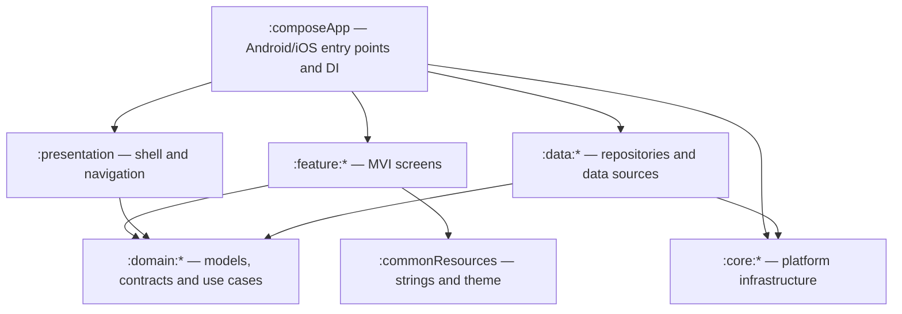

# PhysioApp

**English** · [Español](README.es.md)

An **offline-first** app for physiotherapists and physiotherapy clinics to manage professionals, patients, clinical reports and invoices from **iPad and Android tablets**, keeping all information in a local on-device database.

> **Project status: pre-alpha.**
> Phases 0–10 of the plan are done: rename to PhysioApp (`com.connectapp.physioapp`), cleanup of the starting template (*CleanArch*), encrypted local persistence, **local authentication** (registration, recovery code, login, professional onboarding and inactivity lock), the **tablet shell** (adaptive Home with the eight sections), **professional records** (register, search, edit, archive) **patient records** with their signed consent to data processing, **clinical reports** (with edit history and annulment) and **payment receipts**, with **PDF export** of receipts and reports, and the **hardening** phase (password change and recovery-code regeneration in Settings, accessibility review, UI tests on both platforms, privacy audit and third-party licence inventory), plus, at the owner's request, the open-source licences screen, **encrypted backups** that can be restored on another tablet and **content hidden in screenshots and the app switcher**. Development is complete; what remains is manual testing on real tablets, and the steps listed under [Limitations and roadmap](#limitations-and-roadmap) for whoever deploys it in a clinic. **Receipts are internal payment receipts, not Spanish tax invoices.** The full plan is in [`docs/00-auditoria-y-plan.md`](docs/00-auditoria-y-plan.md) (in Spanish).

## Table of contents

1. [Target audience and scope](#target-audience-and-scope)
2. [Features](#features)
3. [Platforms](#platforms)
4. [Offline philosophy and privacy](#offline-philosophy-and-privacy)
5. [Tech stack](#tech-stack)
6. [Architecture](#architecture)
7. [Data model](#data-model)
8. [Installation and setup](#installation-and-setup)
9. [Usage](#usage)
10. [Testing and quality](#testing-and-quality)
11. [Security](#security)
12. [Limitations and roadmap](#limitations-and-roadmap)
13. [Contributing](#contributing)
14. [License and attributions](#license-and-attributions)
15. [Maintenance](#maintenance)

## Target audience and scope

- **Users:** physiotherapists and physiotherapy clinic staff who work on tablets.
- **Scope:** local authentication, patient and professional records, clinical reports and payment receipts with PDF export, all without an Internet connection or servers.

## Features

| Feature | Status |
|---|---|
| Local sign-up and sign-in (salted, hashed passwords) | Implemented (phase 4) |
| Offline password recovery | Implemented: one-time recovery code shown at registration; reset with email + code |
| Mandatory onboarding: signed-in professional's record (NIF/NIE, licence number) | Implemented (phase 4) |
| Inactivity lock and login lockout | Implemented with the confirmed values (decision D14): 5 min; 5 failures → 5 min; "Remember session" off by default |
| Home with shortcuts to patients, professionals, reports and invoices | Implemented (phase 5): 8 cards in an adaptive grid; every section has its screens since phase 9 |
| Patients: creation with handwritten signature, single-criterion search, editing, deletion | Implemented (phase 7): identity document NIF/NIE, passport or other; the patient (or legal representative) signs the consent to data processing at creation, the signature history is kept and they can sign again; search by document, full name or email; archive/restore; permanent deletion only without reports or invoices. **The consent text is provisional, pending legal review** |
| Professionals: creation, search, editing, deletion | Implemented (phase 6): professional association from a closed list of the 17 regional ones, search by one criterion, edit, archive/restore, permanent deletion only without account, reports or invoices |
| Clinical reports: unique code, patient autocomplete, search and detail | Implemented (phase 8): random unique code `INF-XXXXXXXX`; author = signed-in professional; patient picker with suggestions (active patients only); search by report number, patient name or patient document; only the author can edit (earlier versions are kept and can be viewed) or annul with a reason; reports are never deleted; anyone can export the current version to PDF (phase 9) |
| Invoices: creation, payment indicator, search, PDF export | Implemented (phase 9) as an **internal payment receipt, not a tax invoice** (decision D6): sequential gapless number per year (`2026-000001`); author = signed-in professional; issuer and patient data copied when issued; concept, exact amount, paid flag and optional payment method; "Save" and "Save and export PDF"; search by number, patient name or patient document; only the author can mark it as paid/pending or void it with a reason (it keeps its number); receipts are never deleted. Screen and PDF say "This document is not an invoice" and carry the VAT exemption note |
| Signed-in professional's profile | Read-only (account and professional record); editing pending |
| Settings | Implemented (decision D15): user header, **Change password** (current password + new one), **Regenerate recovery code** (asks for the password, shows the new code once and the old one stops working), "About" (version), **Open-source licences** (the third-party software included and the full text of each licence, readable offline), **Backups** (create and restore, with the date of the last one) and "Sign out". No preferences |
| Encrypted backups | Implemented (plan §21.7, 2026-10-21): Settings → **Create backup** writes the whole database to a file encrypted with a password chosen at that moment and opens the system "save to" picker; **Restore backup** replaces all the data on the tablet after asking for the backup password, your sign-in password and a confirmation. On a tablet without accounts (new or reinstalled), the sign-in screen offers the restore. Home reminds you when there has never been a backup or the last one is 7 days old |

Template features that are not part of PhysioApp (sample orders, backend login, Sentry analytics, notifications, Settings preferences, profile editing and sample privacy policy) **were removed in phase 2**.

## Platforms

- **Tablets only**: **iPad** (the iOS app does not install on iPhone) and **Android tablets** (the app declares large and extra-large screens only, so Google Play does not offer it on phones).
- Portrait and landscape. The layout adapts to the window width, including iPad Split View and Android multi-window.
- Current project values (inherited from the template, pending review): Android `minSdk 26` / `targetSdk 36`; iOS `IPHONEOS_DEPLOYMENT_TARGET 18.2`.
- Specific device requirements: *to be verified*.

## Offline philosophy and privacy

- Data is stored **only on the device**, in a local SQLite database (SQLDelight) encrypted with SQLCipher. Its key is kept in Android Keystore / iOS Keychain and never leaves the device.
- **Shared clinic model:** a device can hold several accounts, and every professional sees every patient on it. Each report and receipt records its author, and only the author can modify or cancel it. The clinic must document this shared access as part of its processing.
- **Nothing clinical is erased:** deleting a patient or professional archives them (they can be restored), physical deletion is only allowed when they have no reports or receipts, and receipts are voided instead of deleted, keeping their number. This preserves the clinical records Spanish law requires to be kept (Ley 41/2002, at least 5 years).
- The app **uses no backend, cloud services, analytics or telemetry**.
- PhysioApp processes **health data** (a special category under the GDPR). Keeping data locally **does not remove** the legal obligations of whoever uses the app (the data controller): legal basis, retention of clinical records, device security and backups. The app is no substitute for legal review.

## Tech stack

Versions taken from [`gradle/libs.versions.toml`](gradle/libs.versions.toml) and [`gradle/wrapper/gradle-wrapper.properties`](gradle/wrapper/gradle-wrapper.properties):

| Area | Technology | Version |
|---|---|---|
| Language | Kotlin Multiplatform | 2.3.21 |
| Build | Gradle / Android Gradle Plugin | 9.3.1 / 9.1.0 |
| Gradle daemon JDK | JetBrains (toolchain) | 21 |
| UI | Compose Multiplatform + Material 3 | 1.11.0 / 1.10.0-alpha05 |
| Navigation | Navigation3 | 1.1.1 |
| Presentation | MVI (`:core:mvi` module) | — |
| Dependency injection | Koin | 4.2.1 |
| Persistence | SQLDelight | 2.3.2 |
| Database encryption | SQLCipher Community (Android: `net.zetetic:sqlcipher-android`; iOS: Swift package `SQLCipher.swift`) | 4.17.0 |
| Cryptography | `:core:crypto` on top of system APIs (JCA on Android, CommonCrypto/Security on iOS) | — |
| Secure storage | KVault (Keystore / Keychain) | 1.12.0 |
| Static analysis / coverage | detekt / Kover | 1.23.8 / 0.9.9 |
| UI tests (test only) | Compose UI Test; Robolectric on the Android host | 1.11.0; 4.17 |

The app includes no HTTP client and no analytics or telemetry SDK: Ktor and Sentry, inherited from the template, were removed in phase 2. The Android APK does not declare the `INTERNET` permission.

## Architecture

Multi-module Clean Architecture with MVI. Allowed dependencies between layers are **checked at build time** by the `verifyModuleBoundaries` task (rules in [`build-logic/src/main/kotlin/physioapp/convention/ModuleBoundaries.kt`](build-logic/src/main/kotlin/physioapp/convention/ModuleBoundaries.kt)).



| Folder | Current contents |
|---|---|
| `composeApp/` | `MainActivity` (Android), `MainViewController` (iOS), Koin module composition, database passphrase provider |
| `presentation/` | `MainScreen`, top/bottom bars, navigation routes and back stack, inactivity lock |
| `feature/` | `splash`, `login`, `register`, `onboarding`, `forgot_password`, `home`, `profile`, `settings`, `professionals`, `patients`, `reports`, `invoices`, `backup` |
| `domain/` | `auth` (account, professional record, session and lockout policies, use cases), `settings` (only `AppVersionProvider`), `professionals`, `patients`, `reports` and `invoices` (records, validation, use cases; consent version), `backup` (backup contract, password rule, 7-day reminder), `shared` (name, email, phone, password, NIF/NIE, identity-document and licence-number validators; report codes; catalogue of the 17 professional associations; `Money` in cents; `RecoveryCode`; `SearchText`; the patient option of the pickers) |
| `data/` | `auth` (repository on `PhysioDatabase`; session in a device-bound KVault store), `professionals`, `patients`, `reports` and `invoices` (repositories on `PhysioDatabase`; gapless receipt numbering), `backup` (backups through `:core:database`; date of the last one in a device-bound KVault store) |
| `core/` | `database` (`PhysioDatabase` encrypted with SQLCipher), `crypto` (PBKDF2, secure random), `storage` (KVault), `mvi`, `pdf` (offline PDF generator in common Kotlin, no libraries), `uitest` (test support only: shared base and helpers for the Compose UI tests) |
| `commonResources/` | Shared strings (English/Spanish), Material 3 theme derived from the logo, window width classes, `ListDetailLayout`, `EmptyState`, `ValidatedTextField`, `SelectField`, `SignaturePad` (with PNG export), `RecoveryCodePanel`, `PatientPicker`, `ErrorMessage`, `LoadingIndicator`, unsaved-changes guard, date formatting, PDF share/save on each platform with its warning |
| `build-logic/` | Gradle convention plugins (`physioapp.kmp.base`, `physioapp.kmp.compose`, `physioapp.module-boundaries`) |
| `iosApp/` | Host Xcode project |
| `docs/` | Plan, decisions, provenance and the third-party licence inventory |

The architecture is described in the [plan, §5](docs/00-auditoria-y-plan.md#5-arquitectura-propuesta-coherente-con-la-plantilla).

## Data model

The **v1** schema lives in [`core/database/src/commonMain/sqldelight/`](core/database/src/commonMain/sqldelight/): tables `account`, `professional`, `patient`, `patient_signature`, `clinical_report`, `clinical_report_version`, `invoice_series` and `invoice`. It uses text keys (UUID), foreign keys enabled on every connection, soft deletion (`archived_at`) with `ON DELETE RESTRICT` for referenced rows, gapless receipt numbering per yearly series and amounts in cents. The [`1.db`](core/database/src/commonMain/sqldelight/databases/) snapshot allows verifying future migrations (`./gradlew verifySqlDelightMigration`).

Authentication already uses `account` and `professional`: each account is linked 1:1 to its professional record, created in the onboarding step or linked to an existing one with the same NIF, association and licence number. A licence number is unique within its association, since each one numbers its members independently. The template's unencrypted profile cache (`AuthDatabase`) was removed in phase 4. The receipt is not a tax invoice (D6); it stores the issuer and recipient data and the VAT treatment so that it can evolve into one. As long as no version has been distributed, v1 can be changed without a migration ([plan, §6](docs/00-auditoria-y-plan.md#6-modelo-de-datos-propuesta)).

## Installation and setup

### Prerequisites

- Android Studio with the Kotlin Multiplatform plugin.
- Xcode (for iPadOS) — minimum version *to be verified*.
- Gradle automatically downloads the JDK 21 its daemon needs.
- The first iOS build needs a connection: Xcode downloads the Swift package `SQLCipher.swift` 4.17.0, pinned in `iosApp/iosApp.xcodeproj/project.xcworkspace/xcshareddata/swiftpm/Package.resolved`.

### Cloning

Repository: <https://github.com/ManuelAf-ConnectApp/PhysioApp>

```bash
git clone https://github.com/ManuelAf-ConnectApp/PhysioApp.git
cd PhysioApp
```

### Configuration

No configuration is needed: there are no backend URLs, API keys or telemetry DSNs. The version shown in Settings comes from `-PreleaseVersionName` (default `1.0`).

### Build and run

**Android** (verified 2026-10-20):

```sh
./gradlew :composeApp:assembleDebug
```

You can also use Android Studio's `composeApp` run configuration with a tablet or a tablet emulator.

**iPadOS**: open `iosApp/iosApp.xcodeproj` in Xcode and run the `iosApp` scheme on an iPad simulator (Apple Silicon Mac: the project only builds the `iosSimulatorArm64` target). Command-line build, verified 2026-10-20:

```sh
xcodebuild -project iosApp/iosApp.xcodeproj -scheme iosApp -sdk iphonesimulator \
  -destination "generic/platform=iOS Simulator" ARCHS=arm64 CODE_SIGNING_ALLOWED=NO build
```

To check only the Kotlin/Native code (verified 2026-10-20):

```sh
./gradlew linkDebugFrameworkIosSimulatorArm64
```

## Usage

Current flows (authentication, professionals, patients, reports, receipts and backups):

1. **Sign up**: first name, last names (not blank), email and password. Each field shows its error when you leave it, and the button stays disabled until everything is valid. The password needs at least 12 characters with uppercase, lowercase, digit and symbol.
2. **Recovery code**: shown **once** after registration (`XXXXX-XXXXX-XXXXX-XXXXX`). Write it down and confirm you have saved it: it is the only way to reset the password. Registering does not sign you in.
3. **Sign in**: a wrong password and an unknown email give the same message. After 5 consecutive failures, sign-in is locked for 5 minutes.
4. **Onboarding**: on the first sign-in you complete your professional record (NIF/NIE, professional association and licence number exactly as on your certificate; name and last names are prefilled).
5. **Home**, with the bottom bar **Home · Profile · Settings** and eight cards: register and find patients, professionals, reports and receipts. On a tablet in landscape the cards are shown in two rows of four, in portrait on most tablets, in four rows of two. Each card opens its section with a back arrow in the top bar. Profile shows your account and record; Settings lets you change your password, regenerate the recovery code, see the version and the open-source licences, and sign out.
6. **Forgot password**: email + recovery code + new password. A new recovery code is issued and the old one stops working.
7. After **5 minutes of inactivity** the session is closed, also if the app is restarted.
8. **Register professional**: NIF/NIE, association, licence number, first name and last names are required; email, phone, address and notes are optional. Saving opens the new record.
9. **Find professional**: choose one criterion (NIF/NIE, full name or licence number) and type; accents and case are ignored. "Show archived" adds archived records. In landscape the record opens next to the list; in portrait it opens as its own screen. From the record you can **edit** it, **archive** it (it disappears from searches and can be restored) or, if it has no account, reports or receipts, **delete it permanently**. Both archiving and deleting ask for confirmation.
10. **Register patient**: identity document (NIF/NIE, passport or another document, e.g. the guardian's for a minor), first name and last names are required; email, phone, address and notes are optional. Below, the consent text (marked as provisional) and the signature pad: choose who signs (the patient or a legal representative, whose name and document are then required), sign with a finger or stylus and use "Clear" to repeat. Saving is disabled until there is a signature.
11. **Find patient**: by document, full name or email, like professionals. The record shows the latest signature, who signed, when and the consent text version. **Sign again** adds a new signature and keeps the earlier ones. Editing the data does not require signing again.
12. **Unsaved changes**: leaving a form with changes (back arrow, system back or bottom bar) asks whether to discard them.
13. **Create report**: the professional is the signed-in one and cannot be changed; type in "Patient" to get suggestions (active patients only) and pick one; fill in the report details and the patient's condition. Saving opens the report with its code (`INF-…`).
14. **Find report**: by report number, patient name or patient document; newest first, annulled reports marked. The report shows its dates, the patient and the author. Only the author sees **Edit** (each edit keeps the previous text, viewable under "Show earlier versions") and **Annul** (asks for a reason; the report stays visible as annulled). Reports are never deleted. **Export PDF** is open to every professional.
15. **Create receipt**: a notice says it is not an invoice; the professional is the signed-in one; pick the patient from the suggestions; the concept starts as "Physiotherapy session"; type the amount (`45`, `45,5` or `45.50`) and tick "Paid" to choose an optional payment method. **Save** opens the receipt with its number (`2026-000001`); **Save and export PDF** opens it with the export dialog.
16. **Find receipt**: by number, patient name or patient document; voided receipts are marked and paid/pending is shown. Anyone can **Export PDF**; only the author can **Mark as paid**/**Mark as pending** or **Void** it (asks for a reason). Receipts are never edited or deleted: to correct one, void it and issue another.
17. **Change password** (Settings): type the current password and the new one twice. The session stays open. Five wrong current passwords count as failed sign-ins: the account is locked for 5 minutes and the session ends.
18. **Regenerate recovery code** (Settings): type your password; the new code is shown once and the previous one stops working. "Back to Settings" is enabled once you confirm you have stored it.
19. **Open-source licences** (Settings): the third-party software in the app grouped by licence, with its copyright holders; tap a licence to read its full text.
20. **Export PDF** (receipts and reports): a warning says the PDF contains personal and health data and leaves the app's protection; then **Share** (system share sheet) or **Save to…** (choose a folder or app). The temporary copy is deleted afterwards (on Android, before the next export or when the app starts).
21. **Create backup** (Settings, or "Make a backup" on Home's reminder): type a backup password twice (same rules as account passwords) and choose where to save the file (`physioapp-copia-<date>-<time>.physiobackup`), ideally outside the tablet. Write the password down and keep it apart from the file: it is not stored anywhere and cannot be recovered. It only counts as the last backup once the file has been saved.
22. **Restore backup** (Settings): choose the file, type its password and your sign-in password, and confirm. All the data on the tablet is replaced by the backup's (accounts included), the session ends and you sign in with an account from the backup. On a new or reinstalled tablet, use **"New tablet? Restore a backup"** on the sign-in screen, which only asks for the backup password.

## Testing and quality

| Command | What it does | Status |
|---|---|---|
| `./gradlew testAndroidHostTest testDebugUnitTest` | Unit, schema, repository and **UI** tests for every module on the JVM (UI tests under Robolectric, as a landscape tablet) | Verified 2026-10-21 (after backups): 371 tests, 0 failures, 37 of them UI tests |
| `./gradlew iosSimulatorArm64Test` | Tests of the shared modules on the iOS simulator, including real encryption (linking the official `SQLCipher.xcframework`, verified by checksum) and the same UI tests | Verified 2026-10-21: 308 tests, 0 failures, 37 of them UI tests; backups are created and restored with the real SQLCipher |
| `./gradlew :core:database:connectedAndroidDeviceTest` | On-disk encryption on a connected Android device or emulator | Verified 2026-10-16 (API 37 emulator): 7 tests, 0 failures |
| `./gradlew verifySqlDelightMigration` | Consistency of the schema with its migrations | Verified 2026-10-21 |
| `./gradlew build` | Compilation, Android lint, tests and module dependency verification | Run by CI (`:composeApp:lintDebug` and `verifyModuleBoundaries` verified locally 2026-10-21) |
| `./gradlew detekt` and `./gradlew -p build-logic detekt` | Static analysis | Verified 2026-10-21: no findings outside the existing baselines |
| `./gradlew koverHtmlReport` | Aggregated coverage report in `build/reports/kover/html` | Run by CI |

**UI tests** live in each module's `commonTest` (classes ending in `UiTest`) and run unchanged on both platforms: they extend `UiTest` from `:core:uitest` and use the feature's real Koin modules with fake repositories. They cover sign-in (valid, invalid, remember session), registration validation and the recovery code, password recovery, Settings, patient registration with a drawn signature, the excluding search with archived records and the list-detail layout at both widths, confirmed deletion and archiving, report creation with patient suggestions and author-only actions, receipts (validation, paid indicator, PDF warning) and the shell (heading, unsaved-changes dialog) the open-source licences screen (every bundled licence text opens), backups (password rules, restore with confirmation, with or without a session) and the restore option on the sign-in screen of a tablet without accounts.

**Accessibility** (reviewed in phase 10): every icon button has a description, decorative icons have none, selectable rows announce their selected state, section titles are headings, errors and the loading indicator are announced, buttons grow with the system font size, and every text/background pair meets WCAG AA (≥ 4.5:1) in light and dark themes. The signature pad has a description but needs touch input: a patient who cannot sign can be represented by a legal representative (D13). Not yet checked with TalkBack or VoiceOver on a device.

**Manual testing:** the authentication flow was checked on an Android emulator with the real encrypted database (2026-10-19). Still pending: the whole flow on iPad, real-time expiry of the inactivity lock on both platforms, the final look of the launcher icons and the phase 5 tablet shell (Home grid and navigation in portrait and landscape on an Android tablet and an iPad, including Split View) the phase 6 professional screens ([plan §17.3](docs/00-auditoria-y-plan.md#173-pendiente-de-prueba-manual-propietario)) and the phase 7 patient screens, including the signature image on both platforms ([plan §18.3](docs/00-auditoria-y-plan.md#183-pendiente-de-prueba-manual-propietario)), the phase 8 report screens ([plan §19.3](docs/00-auditoria-y-plan.md#193-pendiente-de-prueba-manual-propietario)) the phase 9 receipts and PDF sharing/saving on both platforms ([plan §20.3](docs/00-auditoria-y-plan.md#203-pendiente-de-prueba-manual-propietario)) the phase 10 Settings screens and screen-reader pass ([plan §21.4](docs/00-auditoria-y-plan.md#214-pendiente-de-prueba-manual-propietario)) and backups: saving, choosing the file and restoring on another tablet, on both platforms ([plan §21.7](docs/00-auditoria-y-plan.md#217-ampliación-copias-de-seguridad-cifradas-2026-10-21)). The Android backup test (`PhysioDatabaseBackupTest`) runs with `./gradlew :core:database:connectedAndroidDeviceTest` on a device or emulator.

Continuous integration lives in [`.github/workflows/ci.yml`](.github/workflows/ci.yml) (inherited from the template, with PhysioApp identifiers).

## Security

| Measure | Status |
|---|---|
| Passwords with a strong KDF and per-user salt | Implemented (`:core:crypto`): PBKDF2-HMAC-SHA256, 600,000 iterations, 16-byte random salt, Unicode NFC normalization and constant-time comparison; automatic re-hash if the parameters change. Policy: at least 12 characters with uppercase, lowercase, digit and symbol |
| Offline password recovery | Implemented: one-time 100-bit code, stored only as a PBKDF2 hash, shown once and never copied to the clipboard; a reset issues a new code, and Settings can regenerate it after asking for the password |
| Change password | Implemented (Settings): requires the current password; wrong attempts share the sign-in lockout counter, and reaching the lockout also ends the session |
| Protection against enumeration and brute force | Implemented: unknown emails get the same message and the same verification cost; lockout after 5 failures for 5 minutes |
| Encrypted database | Implemented: SQLCipher 4.17.0 with a random 256-bit passphrase stored in Keystore/Keychain (on iOS, `WhenUnlockedThisDeviceOnly`). The app **refuses to open** the database if the runtime is not SQLCipher. Verified on an Android emulator and the iOS simulator: no plaintext on disk and cannot be opened with another key |
| Secrets in Keystore / Keychain | Implemented (KVault). The session keeps only the account id and the last activity, in a device-bound store |
| Inactivity lock | Implemented: 5 minutes, also across restarts |
| OS automatic backups disabled | Implemented. Android: `allowBackup="false"` and `data_extraction_rules.xml`, which also excludes device-to-device transfer. iOS: the database folder is excluded from iCloud/computer backups and its files use `NSFileProtectionCompleteUnlessOpen` (unreadable while the iPad is locked); the key never leaves the device (`ThisDeviceOnly`). A system backup could not be decrypted on another device anyway; the app's own encrypted backups cover that (next row) |
| App backups | Implemented (plan §21.7): a SQLCipher file encrypted with its own password (PBKDF2-HMAC-SHA512, 256,000 iterations, random salt, authenticated pages), never with the device key; the password follows the account policy and is not stored. The file is written in the app's private temporary folder and deleted once handed to the "save to" picker; its name only carries the date. A restore checks the password and that the file is a PhysioApp backup of the same database version, and replaces all rows in one transaction (nothing changes if it fails). From Settings it asks for the sign-in password (wrong attempts count towards the lockout) and ends the session; from the sign-in screen it is only allowed on a tablet without accounts. The backup file is as sensitive as the tablet: keeping it safe is up to the clinic |
| Content hidden in screenshots and the app switcher | Implemented (plan §21.8, D21). Android: `FLAG_SECURE` on the window (dialogs and menus inherit it), so screenshots and recordings come out black, the recent apps thumbnail is blank and nothing is shown on non-secure external displays. iPad: a neutral cover (lock and "PhysioApp") replaces the content whenever the app stops being active, so the app switcher snapshot shows no data, and while the screen is recorded, mirrored or shared (AirPlay included). iOS does not let apps block screenshots |
| No personal data in logs | Implemented: the app writes no logs (the SQLite logger is silenced), and models, screen states and intents holding personal data, passwords or codes hide them in `toString()` |
| Signatures | Implemented: PNG inside the encrypted database, shown only in the patient record, never in lists, logs or exports. Simple electronic signature (not a qualified eIDAS signature) |
| Exported PDFs | Implemented (D19): generated in the app's private temporary folder (on iOS with complete file protection) and handed to the system share sheet or "save to" picker, with a warning beforehand; no password. The file name and PDF title only carry the receipt number or report code. iOS deletes the copy when the sheet closes; Android before the next export and at start-up |

> **Warning:** the app is pre-alpha, has not been audited and has not yet been tested manually on iPad. **Do not use this version with real patient data.** To report a vulnerability, see [SECURITY.md](SECURITY.md).

## Limitations and roadmap

PhysioApp is open source and is not tied to any clinic. **The developer who deploys it for a clinic** is responsible for adapting it and for handling the legal and tax matters with that clinic before it is used with real patients:

1. **Consent text:** replace the sample text (`consent_text` in both `strings.xml`, with the clinic's name, contact details and retention period) with the one the clinic approves, remove the "provisional text" notice (`consent_pending_review`) and change `Consent.CURRENT_VERSION` (`domain/patients/.../Consent.kt`); every signature stores the version it signed.
2. **Receipts:** check with the clinic that the internal payment receipt (D6, not a tax invoice) fits its tax situation, or adapt its texts (`invoice_*` strings) and the PDF.
3. **Identifiers and signing:** application id, iOS team and certificates (see [Installation and setup](#installation-and-setup)).
4. **Backups:** agree with the clinic where backup files and their passwords are kept. The prioritized list with recommendations is in the [plan, §4](docs/00-auditoria-y-plan.md#4-decisiones-bloqueantes-priorizadas), the phases in the [plan, §8](docs/00-auditoria-y-plan.md#8-plan-de-implementación-por-fases) and the current status in the [plan, §15](docs/00-auditoria-y-plan.md#15-estado-actual-y-punto-de-reanudación).

Known limitations:

- Typing with the on-screen keyboard without touching the screen does not count as activity for the inactivity lock.
- The system back gesture on the registration recovery-code screen skips the "I have saved it" confirmation; if the code is lost, regenerate it from Settings.
- The consent text is a sample marked as provisional: it must be replaced for each clinic (step 1 above).
- The inactivity lock closes the session even with a form half filled in; what was typed is lost.
- Receipts are not tax invoices (D6): invoices for companies, insurers or patients who ask for one are still issued outside the app.
- PDFs use the standard Helvetica font without embedding it: letters outside Western European Latin lose their diacritic (`Ștefănescu` → `Stefanescu`) and other scripts print as `?`.
- The keyboard may learn words typed in clinical texts (Compose does not expose Android's "no personalized learning" flag); the app sets no extra keyboard restrictions.
- The bottom bar is kept on tablets, as the requirements ask, instead of the navigation rail Material 3 recommends for wide windows.
- Backups are manual: the app reminds you after 7 days but cannot copy anything by itself, since it has no network access. A backup only restores in an app with the same database version (today v1); when the schema changes, restoring older backups will need a migration.
- Restoring replaces everything: there is no way to merge a backup with newer data on the tablet.
- Screenshots are blocked on Android, also deliberate ones (for example, to report a bug); on iPad they cannot be blocked. While the iPad mirrors its screen (AirPlay, a projector) the app shows only its cover.

## Contributing

Read [CONTRIBUTING.md](CONTRIBUTING.md) and the [Code of Conduct](CODE_OF_CONDUCT.md) before contributing. Report vulnerabilities privately as described in [SECURITY.md](SECURITY.md). Changes are tracked in [CHANGELOG.md](CHANGELOG.md). Key rules:

- Respect the layers and dependency rules: `./gradlew build` fails if a module depends on a disallowed layer.
- Every behavior change must include tests in `commonTest` and pass `./gradlew build detekt`.
- Never add analytics, telemetry or network calls, and do not write personal or clinical data to logs.
- Changes via *pull request* against `main`, describing their impact.

## License and attributions

- License: **Apache License 2.0**, see [`LICENSE`](LICENSE). Copyright 2026 Manuel AF.
- Notices and provenance: see [`NOTICE`](NOTICE). PhysioApp derives from the CleanArch template (GPL-3.0), by the same copyright holder, who has chosen to publish the derived code under Apache-2.0. The original license text is kept in [`docs/procedencia/`](docs/procedencia/).
- Third-party licenses: inventory in [`docs/licencias-terceros.md`](docs/licencias-terceros.md) (2026-10-21, in Spanish). Everything shipped is Apache-2.0 except KVault (MIT) and SQLCipher and Skia (BSD-3-Clause), whose notices are reproduced in `NOTICE`; there is no copyleft code. Those notices, and the full licence texts, also ship inside the app: Settings → Open-source licences.

## Maintenance

- Version: `1.0` (inherited initial value, no releases). See [CHANGELOG.md](CHANGELOG.md).
- Owner: Manuel AF. Bugs and questions: [GitHub issues](https://github.com/ManuelAf-ConnectApp/PhysioApp/issues) or <incidencias@connectapp.es>. Security vulnerabilities: privately, as described in [SECURITY.md](SECURITY.md).
