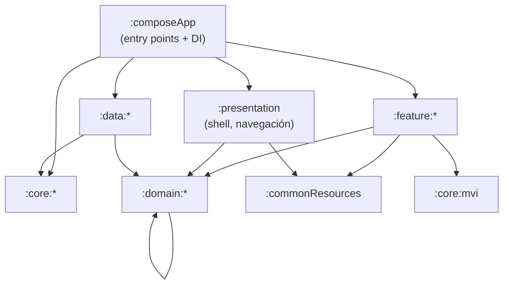
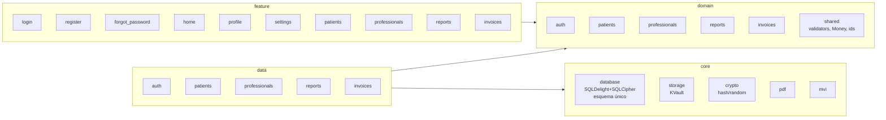
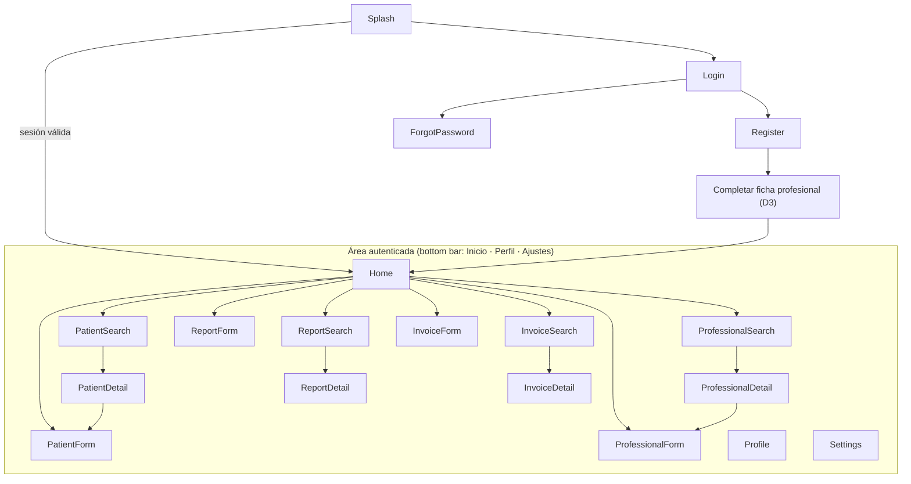
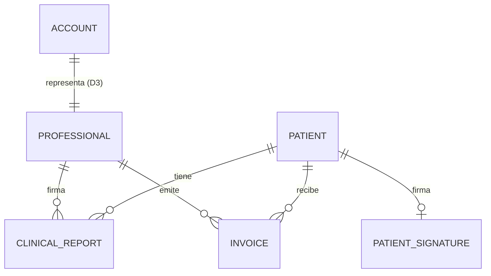

# PhysioApp — Auditoría de la plantilla, plan de migración y diseño inicial

> Documento vivo. Fecha de la auditoría: 2026-10-16. Fuente de requisitos: `physio_app.md` y `physio_app_colegiado.md`, documentos de partida que no se incluyen en el repositorio; lo necesario está recogido en §3 y en las decisiones D1–D21.
> Todo lo marcado **PROPUESTA — REQUIERE CONFIRMACIÓN** no es un requisito cerrado.

---

## 1. Auditoría de la plantilla base (hechos observados)

### 1.1 Identidad y procedencia

| Aspecto | Valor observado | Fichero |
|---|---|---|
| Nombre de la plantilla | **CleanArch** (organización/paquete `connectapp`) | `settings.gradle.kts`, `README.md` |
| Repositorio de origen declarado | `https://github.com/ManuelAf-ConnectApp/CleanArch` | `Wiki.md:4` |
| Licencia de la plantilla | **GNU GPL v3.0** (texto completo, 35 KB) | `LICENSE` |
| Fichero `NOTICE` | No existe | — |
| Cabeceras de licencia en código | Ninguna detectada | — |
| Control de versiones | **El proyecto no es un repositorio propio**: `git rev-parse --show-toplevel` devuelve `$HOME` (repo sin commits que abarca todo el directorio de usuario) | — |

### 1.2 Stack real (extraído de `gradle/libs.versions.toml` y builds)

| Área | Tecnología | Versión |
|---|---|---|
| Lenguaje | Kotlin Multiplatform | 2.3.21 |
| Build | Gradle wrapper / AGP | 9.3.1 / 9.1.0 |
| Android | compileSdk / targetSdk / minSdk | 36 / 36 / 26 |
| iOS | `IPHONEOS_DEPLOYMENT_TARGET` / `TARGETED_DEVICE_FAMILY` | 18.2 / `1,2` (iPhone + iPad) |
| Targets KMP | `androidTarget`, `iosArm64`, `iosSimulatorArm64` | — |
| UI | Compose Multiplatform + Material 3 | 1.11.0 / 1.10.0-alpha05 |
| Navegación | Navigation3 (`navigation3-ui`, `lifecycle-viewmodel-navigation3`) | 1.1.1 / 2.10.0 |
| Patrón de presentación | MVI propio (`:core:mvi` → `StateViewModel`, `MviViewModel`) | — |
| DI | Koin (core, compose, compose-viewmodel, android) | 4.2.1 |
| Persistencia | SQLDelight (driver Android / native), **sin cifrado** | 2.3.2 |
| Almacenamiento seguro clave-valor | KVault (Keystore / Keychain) | 1.12.0 |
| Red | Ktor Client (OkHttp / Darwin) | 3.5.2 |
| Telemetría | Sentry Android (opt-in) | 8.54.0 |
| Calidad | detekt (+formatting), Kover, verificación de fronteras de módulos | 1.23.8 / 0.9.9 |
| CI/CD | GitHub Actions: build+lint+tests, detekt, Kover, compilación iOS, release firmada por tag | `.github/workflows/ci.yml` |

### 1.3 Módulos y reglas de dependencia

27 módulos Gradle. Las reglas se **verifican en build** (`verifyModuleBoundaries`, `build-logic/.../ModuleBoundaries.kt`):



| Capa | Módulos actuales |
|---|---|
| domain | `auth`, `orders`, `settings`, `analytics` |
| data | `auth`, `orders`, `settings`, `analytics` |
| core | `network`, `storage`, `database`, `mvi`, `analytics`, `notifications` |
| feature | `splash`, `login`, `register`, `forgot_password`, `home`, `settings`, `profile`, `orders`, `edit_profile`, `privacy_policy` |
| otros | `presentation`, `commonResources`, `composeApp`, `build-logic` (convention plugins `cleanarch.*`) |

Flujo de datos: `Screen (Compose) → Intent → ViewModel (MVI) → UseCase → Repository (interfaz en domain) → RepositoryImpl (data) → DataSource (Ktor / SQLDelight / KVault)`. Cada `data:*` posee su propio esquema SQLDelight y usa `createSqlDriver()` de `:core:database`.

### 1.4 Incompatibilidades de la plantilla con los requisitos de PhysioApp

| # | Hallazgo | Requisito afectado | Severidad | Acción propuesta |
|---|---|---|---|---|
| A1 | `LICENSE` es **GPL-3.0**, se exige Apache-2.0 | §13.2 | **Bloqueante** | Solo el titular de copyright de CleanArch puede relicenciar. Ver decisión D1. |
| A2 | Autenticación **remota** (Ktor `AuthService`, `baseUrl` obligatorio en build) | §1, §2.4, §3.1 | Alta | Sustituir por autenticación local (SQLDelight + hash de contraseña). Retirar `:core:network` y la propiedad `connectapp.authApiBaseUrl`. |
| A3 | **Puerta trasera** en `LoginViewModel` (`admin@admin.com` / `Admin@2026`) | §9 | **Crítica** | Eliminar en la fase de autenticación. |
| A4 | Sentry (`:core:analytics`, `:data:analytics`, `:domain:analytics`) | §2.8 | Alta | Eliminar: prohibida la telemetría. |
| A5 | `android:allowBackup="true"` | §9 (backups, datos sanitarios) | Alta | Desactivar backup automático / reglas de exclusión hasta decidir política de copias. |
| A6 | SQLDelight **sin cifrar** | §9 | Alta | Cifrado con SQLCipher (PROPUESTA, ver D7). |
| A7 | Módulo demo `orders` (domain/data/feature) | — | Media | Eliminar (código de ejemplo de la plantilla). |
| A8 | `:core:notifications` + permiso `POST_NOTIFICATIONS` + campana en top bar | §3.2 (top bar solo título) | Media | Eliminar. |
| A9 | Top bar con botón atrás y campana | §3.2 | Media | Dejar solo el título. |
| A10 | Bottom bar actual: no coincide con Inicio/Perfil/Ajustes exactos | §3.2 | Baja | Ajustar. |
| A11 | Diseño móvil (no tablet-first, sin lista-detalle) | §10 | Media | Introducir `WindowSizeClass` y patrón lista-detalle. |
| A12 | Ajustes con preferencias predefinidas (notificaciones, modo oscuro, consentimiento analítica) | §3.2 ("no crear preferencias arbitrarias") | Baja | Reducir a lo confirmado (cerrar sesión, versión). |
| A13 | Loader artificial de 1 s en cada navegación iOS (`MainScreen`) | §10 | Baja | Revisar al rehacer el shell. |
| A14 | El proyecto no tiene repositorio git propio | §12 | Media | `git init` dentro de `PhysioApp/` (ver D11). |
| A15 | `kotlin.native.cacheKind=none`, `-Xmx12288M` | — | Info | Se revisará al reducir módulos. |

Aspectos **reutilizables tal cual**: estructura Clean Architecture multi-módulo, verificación de fronteras, MVI, Koin, Navigation3, SQLDelight + `createSqlDriver`, KVault para secretos, detekt, Kover, CI de build/test/compilación iOS.

---

## 2. Plan de renombrado integral a PhysioApp

Auditoría: **≈950 apariciones** de `connectapp` / `cleanarch` / `CleanArch` en ≈110 ficheros (código, tests, Gradle, manifests, Xcode, CI, detekt baselines, docs). Comando de verificación:

```sh
grep -rniI --exclude-dir={build,.gradle,.idea,.kotlin,.git} -E "connectapp|cleanarch|clean ?arch" . | grep -v physio_app.md
```

**D10 resuelta (2026-10-16):** el prefijo de organización es **`com.connectapp`** y se conserva. `connectapp` identifica a la organización, no a la plantilla. Solo se renombra **CleanArch / cleanarch** (122 apariciones en ≈55 ficheros). Identificador de la app: **`com.connectapp.physioapp`**. Los paquetes por capa (`com.connectapp.domain`, `com.connectapp.data`, `com.connectapp.presentation.*`, `com.connectapp.core.*`, `com.connectapp.commonresources`) se quedan como están.

Comando de verificación final (debe devolver solo referencias de procedencia justificadas):

```sh
grep -rniI --exclude-dir={build,.gradle,.idea,.kotlin,.git,procedencia} -E "cleanarch|clean ?arch" . | grep -v -e physio_app.md -e docs/00-auditoria
```

| Ruta / elemento original | Cambio previsto | Motivo | Validación |
|---|---|---|---|
| `settings.gradle.kts` → `rootProject.name = "CleanArch"` | `"PhysioApp"` | Identidad | `./gradlew projects` |
| `build-logic`: plugins `cleanarch.kmp.base`, `cleanarch.kmp.compose`, `cleanarch.module-boundaries`; paquete `cleanarch.convention` | `physioapp.kmp.base`, … ; paquete `physioapp.convention` | "CleanArch" es el nombre del producto plantilla, no un término arquitectónico neutro | Build completo |
| `build-logic`: namespaces derivados `com.connectapp.*` | Sin cambios | Prefijo de organización confirmado | — |
| Paquetes Kotlin por capa `com.connectapp.{domain,data,core,presentation,commonresources}` | Sin cambios | Prefijo de organización confirmado | — |
| Paquete `com.connectapp.cleanarch` y directorios `composeApp/src/*/kotlin/com/connectapp/cleanarch/` | `com.connectapp.physioapp` | Identidad | Build + tests + detekt |
| `composeApp`: `namespace`/`applicationId = com.connectapp.cleanarch` | `com.connectapp.physioapp` | Identidad Android | `assembleDebug`, instalar en tablet |
| `composeApp/.../config/AppConfig` generado en `com/connectapp/cleanarch/config` | `com/connectapp/physioapp/config` | Identidad | Build |
| `composeApp/src/androidMain/res/values/strings.xml` `app_name=CleanArch` | `PhysioApp` | Nombre visible | Launcher |
| `commonResources/.../strings.xml` (es/en) | Revisar textos de marca | Nombre visible | Revisión visual |
| Manifests `core/*`: authorities `${applicationId}.connectapp.core.*` | Sin cambios (organización); se eliminan con los módulos que se retiran | — | Merge de manifest |
| `gradle.properties` `connectapp.authApiBaseUrl` | **Eliminar** (sin backend) | Offline-first | Build sin la propiedad |
| `iosApp/Configuration/Config.xcconfig` `PRODUCT_NAME=CleanArch`, `PRODUCT_BUNDLE_IDENTIFIER=com.connectapp.cleanarch.CleanArch$(TEAM_ID)` | `PhysioApp`, `com.connectapp.physioapp.PhysioApp$(TEAM_ID)` (se mantiene el patrón de sufijo `TEAM_ID` de la plantilla; PROPUESTA: simplificar a `com.connectapp.physioapp` cuando haya cuenta de Apple Developer definitiva) | Identidad iOS | `xcodebuild` |
| `iosApp/iosApp/Info.plist` | Añadir `CFBundleDisplayName=PhysioApp` | Nombre visible | Springboard |
| `iosApp.xcodeproj/project.pbxproj`, `iosApp.xcscheme` (`CleanArch.app`) | `PhysioApp.app` | Identidad | `xcodebuild` |
| `iosApp/ExportOptions.plist`, `ci.yml` (bundle id `com.connectapp.cleanarch.CleanArch…`) | `<bundle-id>` | CI/CD | Lint de workflow |
| `TARGETED_DEVICE_FAMILY = "1,2"` | `2` (solo iPad), aplicado en la fase 5 | Tablet-first | D12 |
| Kover excludes `com.connectapp.*` en `build.gradle.kts` | `<id-base>.*` | Cobertura | `koverHtmlReport` |
| `*/detekt-baseline.xml` | Regenerar tras renombrar | Rutas/IDs cambian | `./gradlew detekt` |
| Bases de datos `AuthDatabase`/`OrdersDatabase`, ficheros KVault | Nuevos nombres `physioapp.db`, `physioapp_secure` | Identidad | Tests de integración |
| `README.md`, `Wiki.md` | README reescrito; Wiki se archiva como procedencia | Documentación | Revisión enlaces |
| `LICENSE` (GPL-3.0) | **Sin cambios hasta D1** | Jurídico | — |

**Migración segura de datos:** la plantilla nunca se ha publicado como PhysioApp y no hay datos reales, por lo que el cambio de `applicationId`/bundle id implica simplemente una app nueva; no hay migración de datos de usuario que preservar. Si existiera una instalación previa de CleanArch en algún dispositivo de pruebas, debe desinstalarse. Se dejará documentado.

---

## 3. Análisis funcional

### 3.1 Requisitos confirmados (de `physio_app.md`)

- Offline real; sin backend, cloud, analítica ni telemetría.
- Android tablets + iPad; UI táctil, adaptable y accesible.
- Login local (email+contraseña, error genérico, hash, nunca texto plano).
- Registro con las reglas de §3.1 (nombre/apellidos no vacíos tras trim, D9 — antes > 3; email sintáctico sin lista cerrada de TLD; contraseña con mayúscula, minúscula, dígito y símbolo; confirmación idéntica; botón deshabilitado hasta validar).
- Home con 8 tarjetas; bottom bar Inicio/Perfil/Ajustes; top bar solo título.
- Pacientes: alta (incluida firma táctil con limpiar/repetir), búsqueda por un único criterio (NIF | nombre+apellidos | email), editar sin duplicar, borrar con confirmación.
- Profesionales: alta, búsqueda (NIF | nombre+apellidos | nº colegiado), editar, borrar con confirmación y protección de vínculos.
- Informes: código visible único autogenerado y no editable, profesional de la sesión no editable, paciente con autocompletado y referencia estable, dos campos multilínea; búsqueda (código | nombre paciente | NIF paciente) y vista detalle.
- Facturas: número del sistema no editable, profesional de sesión, paciente autocompletado, importe exacto, pagado (bool), guardar y guardar+PDF offline; búsqueda, ver, exportar PDF, eliminar con advertencia.

### 3.2 Ambigüedades y huecos (no se implementan como definitivos)

Recuperación de contraseña offline; vínculo cuenta ↔ profesional; campos obligatorios y validación de NIF/NIE/colegiado; alcance legal de la firma; carácter fiscal de la factura; política de borrado/retención; backups; multi-usuario en un dispositivo; Ajustes; acciones sobre informes guardados; licencia y titular de copyright; identificadores definitivos.

---

## 4. Decisiones bloqueantes (priorizadas)

| ID | Pregunta | Opción recomendada | Alternativas y consecuencias | Bloquea |
|---|---|---|---|---|
| ~~D1~~ | Licencia | **RESUELTA (2026-10-16):** el propietario es titular único de CleanArch → PhysioApp bajo Apache-2.0; GPL original archivada en `docs/procedencia/` | — | — |
| ~~D2~~ | Titular de copyright y año | **RESUELTA:** Manuel AF, 2026 | — | — |
| ~~D3~~ | Vínculo cuenta ↔ profesional | **RESUELTA (2026-10-16):** 1:1 obligatoria. Tras registrarse, la persona completa su ficha profesional (NIF, nº de colegiado) antes de acceder a Home | — | — |
| ~~D4~~ | Recuperación de contraseña offline | **RESUELTA (2026-10-16):** código de recuperación de un solo uso, mostrado una única vez al registrarse; solo se guarda su hash. Restablecer exige email + código | — | — |
| ~~D5~~ | Uso multi-profesional en un dispositivo | **RESUELTA (2026-10-20):** clínica compartida. Varias cuentas en el mismo dispositivo; todos los profesionales ven todos los pacientes; cada informe/factura registra su autor (profesional de la sesión, no editable). Matices: (1) solo el autor puede modificar o anular sus informes y facturas, los demás solo los consultan (se concreta en las fases 8–9); (2) si un profesional dado de alta sin cuenta se registra después, el onboarding **enlaza** su ficha existente cuando coinciden NIF/NIE y nº de colegiado, en lugar de rechazar el NIF duplicado (fase 6) | — | — |
| ~~D6~~ | ¿Factura fiscal o justificante interno? | **RESUELTA (2026-10-20): "justificante de pago" interno, no fiscal.** El PDF y la pantalla lo rotulan "Este documento no es una factura"; numeración correlativa sin huecos por serie anual (`2026-000001`), asignada en la misma transacción que el alta; nunca se borra: el autor lo **anula** con motivo y conserva su número (D8, D5); emisor = profesional autor (nombre, NIF/NIE, colegio y nº de colegiado); mención "Operación exenta de IVA (art. 20.Uno.3º LIVA)"; el modelo guarda importe y tipo por separado para poder evolucionar a factura fiscal sin rehacerlo. Las facturas fiscales (empresas, aseguradoras o pacientes que la pidan) las sigue emitiendo la clínica con su gestoría o programa de facturación. **Pendiente de confirmar por la gestoría de la clínica** antes de usar la app con pacientes reales | Descartada por ahora: factura fiscal completa (RD 1619/2012, rectificativas, Verifactu como sistema informático de facturación desde 2027) → proyecto propio con asesoría | — |
| ~~D7~~ | Cifrado de la base de datos | **RESUELTA (2026-10-16):** SQLCipher 4.17.0 en ambas plataformas, frase de paso aleatoria en Keystore/Keychain (ver §13) | — | — |
| ~~D8~~ | Borrado de pacientes/profesionales/facturas con referencias | **RESUELTA (2026-10-20):** "Borrar" un paciente o profesional lo **archiva** (`archived_at`): desaparece de búsquedas y autocompletado, pero sigue con su nombre en informes y facturas antiguos. Se puede **desarchivar** (opción "Mostrar archivados" en la búsqueda). Borrado físico solo si no tiene informes ni facturas (alta errónea). Las facturas nunca se borran: se **anulan** (`status = VOIDED`) y conservan su número. Acciones sobre informes: fase 8. Las solicitudes de supresión del RGPD las gestiona la clínica fuera de la app (limitadas por la obligación de conservar la historia clínica) | — | — |
| ~~D9~~ | Obligatoriedad y validación de datos | **RESUELTA (2026-10-20):** **Profesional:** NIF/NIE (letra de control) obligatorio y único; **colegio profesional** obligatorio, de una lista cerrada con los 17 colegios autonómicos del Consejo General (Ceuta y Melilla no tienen colegio propio: se elige el colegio real de colegiación; sin opción "Otro"); **nº de colegiado** obligatorio, texto de 1–20 caracteres (letras ASCII, dígitos, espacios interiores, `.`, `/`, `-`, con al menos una letra o dígito; se conservan ceros y separadores), **único por colegio + número normalizado** (mayúsculas, espacios colapsados); **sin estado de colegiación** (PENDIENTE/VERIFICADO) mientras no haya roles ni fuente verificable offline: comprobar la colegiación es responsabilidad de la clínica. Especificación y fuentes en `physio_app_colegiado.md`. Implementado ya el validador; el colegio en esquema, onboarding y ficha se hace al empezar la fase 6; nombre y apellidos obligatorios; email (formato), teléfono (dígitos, espacios y `+`, de 9 a 15 dígitos), dirección y notas opcionales. El email de la ficha es de contacto: no es único ni tiene que coincidir con el de la cuenta. **Paciente:** documento obligatorio de tres tipos — NIF/NIE (letra de control), pasaporte u otro (p. ej. menor sin DNI con el documento del tutor) —, único por tipo + número (`patient.nif` pasa a `document_type` + `document_number` en la fase 7, sin migración porque no hay versión publicada); nombre y apellidos obligatorios; resto opcional como en profesional. **Nombres** (cuentas, profesionales y pacientes): no vacíos tras trim, en lugar de > 3 caracteres (aplicado ya al registro y al onboarding) | — | — |
| ~~D10~~ | Identificador definitivo | **RESUELTA (2026-10-16):** prefijo `com.connectapp` → app `com.connectapp.physioapp` | — | — |
| ~~D11~~ | Repositorio git propio | **RESUELTA (2026-10-16):** el propietario creará el repositorio más adelante; Claude no crea repos ni hace commits | — | — |
| ~~D12~~ | ¿Solo iPad o también iPhone? | **RESUELTA (2026-10-20):** solo tabletas. iOS `TARGETED_DEVICE_FAMILY = 2` (solo iPad); Android declara solo pantallas `large`/`xlarge` | — | — |
| ~~D13~~ | Firma: alcance y momento | **RESUELTA (2026-10-20):** firma del **consentimiento de tratamiento de datos personales y de salud** (RGPD/LOPDGDD) en el **alta**, **obligatoria** para guardarla, con limpiar/repetir; la app muestra siempre el texto que se firma. No incluye el consentimiento informado clínico (Ley 41/2002), que si hace falta por escrito irá con los informes (fase 8). Firmante: el paciente o su **representante legal** (se guardan su nombre y documento). Editar el paciente no obliga a refirmar; acción "Volver a firmar". Se guarda PNG en la BD cifrada con fecha, firmante y **versión del texto**, conservando el **historial** (no se sobrescribe: el esquema dejará `INSERT OR REPLACE`). Solo visible en la ficha; nunca en listados, logs ni exportaciones. Firma electrónica simple (no cualificada eIDAS). **Texto provisional marcado "pendiente de revisión jurídica"**: la clínica o su DPD deben sustituirlo antes de usar la app con pacientes reales | — | — |
| ~~D19~~ | Protección de los PDF exportados (justificantes e informes) | **RESUELTA (2026-10-20):** el PDF se genera en una carpeta temporal privada de la app, se abre el diálogo de compartir/guardar del sistema y se borra al terminar (y al arrancar, por si quedó alguno). En Android, que no avisa de cuándo la app receptora termina de leer, se borra antes de la siguiente exportación y al arrancar (§20.1). Sin contraseña ni librerías nuevas. Antes de compartir, un aviso indica que el documento sale de la protección de la app | Descartado: PDF con contraseña (en Android exige PdfBox-Android) | — |
| ~~D14~~ | Política de sesión | **RESUELTA (2026-10-21):** se confirman los valores aplicados en la fase 4: cierre de sesión tras **5 min** de inactividad (también entre reinicios), bloqueo tras **5 contraseñas erróneas durante 5 min** y "Recordar sesión" **desactivado por defecto** | — | — |
| ~~D15~~ | Ajustes | **RESUELTA (2026-10-21):** Cerrar sesión, "Acerca de" (versión), **Cambiar contraseña** (pide la actual y la nueva con la política de D16) y **Regenerar código de recuperación** (pide la contraseña, muestra el nuevo una sola vez e invalida el anterior). Sin licencias de terceros ni texto del consentimiento en Ajustes por ahora | — | — |
| ~~D16~~ | Política de contraseña | **RESUELTA (2026-10-16):** mínimo 12 caracteres + mayúscula, minúscula, dígito y símbolo; PBKDF2-HMAC-SHA256, 600 000 iteraciones, sal de 16 bytes | — | — |
| ~~D17~~ | Acciones sobre informes guardados | **RESUELTA (2026-10-20):** ver: cualquier profesional; **editar: solo el autor, guardando cada versión anterior** (el detalle muestra la fecha de modificación y permite ver las versiones); **sin borrado**: el autor puede **anular** con motivo obligatorio y el informe sigue visible marcado como anulado; **exportación a PDF aplazada a la fase 9** (con `core:pdf` y el diseño de protección de PDFs). Por defecto: código visible `INF-` + 8 caracteres aleatorios sin ambiguos con control de colisiones; selector de paciente sin archivados; búsqueda "por NIF del paciente" = por documento del paciente | — | — |
| ~~D18~~ | Consentimiento informado clínico escrito | **RESUELTA (2026-10-20):** fuera de la fase 8. Ley 41/2002 art. 8 solo lo exige por escrito para técnicas invasivas o de riesgo (p. ej. punción seca); la clínica lo gestiona en papel. Ampliación futura posible: consentimiento firmado por técnica vinculado al informe, reutilizando `SignaturePad` | — | — |

Todas las decisiones D1–D19 están resueltas (2026-10-21).

---

## 5. Arquitectura propuesta (coherente con la plantilla)

Se mantiene el patrón de la plantilla: un módulo por contexto en `domain`/`data`/`feature`, MVI, Koin, Navigation3 y verificación de fronteras. La lógica de negocio (validaciones, generación de códigos, búsqueda) vive en `domain` (Kotlin puro, 100 % testeable en `commonTest`).



Cambios sobre la plantilla (**PROPUESTA — REQUIERE CONFIRMACIÓN** en lo estructural):

| Cambio | Motivo |
|---|---|
| Esquema SQLDelight **único** en `:core:database` (`PhysioDatabase`) en lugar de uno por `data:*` | Las relaciones entre pacientes, profesionales, informes y facturas exigen claves foráneas e integridad referencial en una misma base de datos; con bases separadas no hay FK. Los `data:*` reciben las queries generadas por DI. Implica permitir el código generado en `core:database` (la regla de fronteras ya lo permite: `data → core`). |
| Nuevos `:core:crypto` (hash de contraseñas, aleatorio seguro) y `:core:pdf` (expect/actual: `PdfDocument` Android, `UIGraphicsPDFRenderer` iOS) | Capacidades de plataforma sin lógica de negocio |
| Nuevo `:domain:shared` | Validadores (email, NIF/NIE, contraseña), `Money` en céntimos, generadores de código |
| Componentes UI compartidos (tarjeta, campo validado, selector de criterio de búsqueda excluyente, autocompletado, superficie de firma, layout lista-detalle) en `:commonResources` o nuevo `:core:designsystem` | Reutilización entre features |
| Se retiran: `core:network`, `core:analytics`, `core:notifications`, `*:analytics`, `*:orders`, `feature:edit_profile` (absorbido en profesional), `feature:privacy_policy` (se reevaluará como "Aviso de privacidad" estático) | Offline, sin telemetría, sin demo |

### 5.1 Navegación



En tablet (ancho ≥ 840 dp) las búsquedas usan **lista-detalle** en dos paneles; en ancho compacto, pantallas apiladas.

---

## 6. Modelo de datos (PROPUESTA)

Claves primarias: `TEXT` UUID v4 (estables, sin colisiones, independientes del orden de alta). Importes en **céntimos (`INTEGER`)**. Fechas en epoch ms UTC. `PRAGMA foreign_keys = ON`.



| Tabla | Columnas principales | Unicidad / índices | Borrado |
|---|---|---|---|
| `account` | `id`, `first_name`, `last_name`, `email_normalized`, `password_hash`, `password_salt`, `kdf_params`, `recovery_code_hash`, `professional_id` FK, `failed_attempts`, `locked_until`, `created_at`, `updated_at` | `UNIQUE(email_normalized)`, `UNIQUE(professional_id)` | Lógico |
| `professional` | `id`, `nif`, `license_number`, `first_name`, `last_name`, `address`, `email`, `phone`, `notes`, `archived_at`, timestamps | `UNIQUE(nif)`, `UNIQUE(license_number)`, índice `(last_name, first_name)` | `RESTRICT` si hay informes/facturas/cuenta |
| `patient` | `id`, `nif`, `first_name`, `last_name`, `address`, `email`, `phone`, `notes`, `archived_at`, timestamps | `UNIQUE(nif)`, índices `(last_name, first_name)`, `email` | `RESTRICT` si hay informes/facturas |
| `patient_signature` | `patient_id` PK/FK, `image_png` BLOB, `captured_at` | — | Con el paciente |
| `clinical_report` | `id`, `code` (visible), `professional_id` FK, `patient_id` FK, `report_text`, `condition_text`, `created_at`, `updated_at` | `UNIQUE(code)`, índices por `patient_id` | Pendiente (§6.2 no define acciones) |
| `invoice_series` | `id`, `prefix`, `next_number` | `UNIQUE(prefix)` | — |
| `invoice` | `id`, `series_id` FK, `number`, `display_number`, `professional_id` FK, `patient_id` FK, `amount_cents`, `currency` (`EUR`), `paid`, `issued_at`, `status` (`ISSUED`/`VOIDED`), timestamps | `UNIQUE(series_id, number)`, `UNIQUE(display_number)` | Anulación (D8) |

- **Código de informe**: 10 caracteres de un alfabeto sin ambiguos (`23456789ABCDEFGHJKLMNPQRSTUVWXYZ`) generados con aleatorio criptográfico; insert con reintento ante violación de `UNIQUE(code)` (control de colisiones).
- **Número de factura**: correlativo dentro de la serie, asignado en la misma transacción que el insert (D6).
- **Búsqueda por nombre**: comparación normalizada (minúsculas, sin tildes) con columnas `*_search` derivadas, por SQLite `LIKE` sin colación ICU.
- **Migraciones**: ficheros `.sqm` de SQLDelight versionados + `verifyMigrations = true` + tests de migración. Nunca se borra una migración publicada.
- **Logs**: prohibido registrar entidades; los `toString()` de modelos con datos personales se redefinen para enmascarar.

---

## 7. Matriz de trazabilidad

| Requisito | Pantalla | Módulos | Entidades | Casos de uso | Pruebas |
|---|---|---|---|---|---|
| Login local | Login | feature/login, domain/auth, data/auth, core/crypto | Account | `LoginUseCase`, `GetSessionStatusUseCase`, `LogoutUseCase` | Unit: credenciales válidas/erróneas, error genérico, bloqueo por intentos; Integración: hash verificado contra BD |
| Registro | Register | feature/register, domain/auth, domain/shared | Account | `RegisterAccountUseCase`, validadores | Unit: cada regla de §3.1, email duplicado (normalizado), confirmación |
| Recuperar contraseña | ForgotPassword | feature/forgot_password, domain/auth | Account | `ResetPasswordWithRecoveryCodeUseCase` | Unit: código inválido no revela si el email existe; código de un solo uso |
| Vínculo cuenta↔profesional | Onboarding / Perfil | feature/profile, domain/auth, domain/professionals | Account, Professional | `LinkProfessionalUseCase`, `ObserveCurrentProfessionalUseCase` | Unit + integración FK |
| Home + navegación | Home, shell | feature/home, presentation | — | — | UI: 8 tarjetas, bottom bar, top bar solo título |
| Alta/edición paciente | PatientForm | feature/patients, domain/patients, data/patients | Patient, PatientSignature | `SavePatientUseCase` | Unit: validación NIF/NIE, edición no duplica; UI: firma limpiar/repetir, aviso cambios sin guardar |
| Búsqueda paciente | PatientSearch/Detail | idem | Patient | `SearchPatientsUseCase(criterio)` | Unit: criterio exclusivo; UI: campos inactivos bloqueados |
| Borrar paciente | PatientDetail | idem | Patient | `ArchivePatientUseCase` | Integración: bloqueo con informes/facturas |
| Profesionales (alta/búsqueda/editar/borrar) | Professional* | feature/professionals, domain/professionals, data/professionals | Professional | `SaveProfessionalUseCase`, `SearchProfessionalsUseCase`, `ArchiveProfessionalUseCase` | Unit: unicidad NIF/colegiado; integración: bloqueo con vínculos |
| Crear informe | ReportForm | feature/reports, domain/reports, data/reports | ClinicalReport | `CreateReportUseCase`, `GenerateReportCodeUseCase`, `SuggestPatientsUseCase` | Unit: código único con colisión simulada; autocompletado |
| Buscar informe | ReportSearch/Detail | idem | ClinicalReport, Patient | `SearchReportsUseCase` | Unit + UI |
| Crear factura | InvoiceForm | feature/invoices, domain/invoices, data/invoices, core/pdf | Invoice, InvoiceSeries | `CreateInvoiceUseCase`, `ExportInvoicePdfUseCase` | Unit: `Money`, correlativo; integración: transacción; manual: PDF + diálogo compartir en ambas plataformas |
| Buscar/exportar/anular factura | InvoiceSearch/Detail | idem | Invoice | `SearchInvoicesUseCase`, `VoidInvoiceUseCase` | Unit + UI |
| Offline | todas | todas | — | — | Test de dependencias: ningún módulo depende de Ktor; Android sin permiso `INTERNET` |
| Renombrado/licencias | — | todas | — | — | `grep` final sin coincidencias, build Android/iOS, revisión LICENSE/NOTICE |

---

## 8. Plan de implementación por fases

| Fase | Contenido | Depende de | Definición de terminado |
|---|---|---|---|
| **0. Documentación y licencia** | README/NOTICE; preservar procedencia de la plantilla; LICENSE según D1 (repositorio git: lo gestiona el propietario) | D1, D2 | 3 ficheros raíz con contenido útil |
| **1. Renombrado integral** | Tabla §2; regenerar baselines detekt | D10 | `grep` sin coincidencias no justificadas; `assembleDebug`, tests y `linkDebugFrameworkIosSimulatorArm64` en verde |
| **2. Poda de la plantilla** | Eliminar orders, analytics/Sentry, network, notifications, backdoor; `allowBackup=false`; top/bottom bar según §3.2; Ajustes mínimos | Fase 1 | Build y tests verdes; Android sin `INTERNET`; sin dependencias Ktor/Sentry |
| **3. Persistencia compartida segura** | `PhysioDatabase` único, SQLCipher + clave en KVault, `:core:crypto`, `:domain:shared` (validadores, Money, códigos) | D7, D16 | Tests de esquema, migración v1 y validadores |
| **4. Autenticación local** | Registro, login, sesión, bloqueo por inactividad, recuperación (D4), vínculo profesional (D3), perfil | Fase 3, D3, D4, D14 | Criterios Dado/Cuando/Entonces §9 superados |
| **5. Shell tablet** | WindowSizeClass, lista-detalle, componentes de diseño, Home 8 tarjetas | Fase 4 | Verificado en tablet Android y simulador iPad, ambos sentidos |
| **6. Profesionales** | Alta, búsqueda excluyente, detalle, edición, archivado | Fase 5, D8, D9 | Tests + criterios |
| **7. Pacientes** | Ídem + firma | Fase 5, D8, D9, D13 | Tests + criterios |
| **8. Informes** | Crear con código único, autocompletado, búsqueda, detalle | Fases 6–7 | Tests + criterios |
| **9. Facturación** | Crear, PDF offline, compartir, búsqueda, anulación | Fases 6–7, D6 | Tests + PDF verificado en ambas plataformas |
| **10. Endurecimiento** | Accesibilidad, pruebas UI, auditoría de privacidad, inventario de licencias, README final | Todas | Checklist §15.9 del enunciado |

### Backlog priorizado (siguiente trabajo)

1. ~~LICENSE Apache-2.0 + NOTICE con titular y año~~ (hecho 2026-10-16).
2. ~~D10~~ resuelta. Pendiente D3 (vínculo cuenta ↔ profesional), necesaria antes de la fase 4.
3. Renombrado integral + verificación. Sin repositorio git aún: antes de renombrar se guarda una copia de seguridad del proyecto fuera de él.
4. Poda de módulos y eliminación de la puerta trasera.
5. Esquema único + SQLCipher + crypto.
6. Autenticación local completa.

---

## 9. Criterios de aceptación — Fase 4 (autenticación)

- **Dado** que no existe ninguna cuenta, **cuando** relleno el registro con datos válidos y una contraseña que cumple la política, **entonces** el botón "Registrar" se habilita, la cuenta se crea con la contraseña hasheada (nunca en claro) y se muestra el código de recuperación una sola vez.
- **Dado** un nombre de 3 caracteres tras eliminar espacios, **cuando** salgo del campo, **entonces** veo un error junto al campo y el botón permanece deshabilitado.
- **Dado** que existe `Ana@Clinica.es`, **cuando** intento registrar `ana@clinica.es`, **entonces** se rechaza por email duplicado.
- **Dado** una cuenta existente, **cuando** introduzco una contraseña incorrecta o un email inexistente, **entonces** veo el mismo mensaje genérico en ambos casos.
- **Dado** una sesión iniciada, **cuando** la app permanece inactiva más del tiempo configurado, **entonces** se exige volver a autenticarse.
- **Dado** que conozco solo el email de una cuenta, **cuando** intento restablecer la contraseña sin el código de recuperación, **entonces** no es posible restablecerla y no se revela si el email existe.
- **Dado** la app instalada en modo avión, **cuando** realizo cualquier flujo de autenticación, **entonces** funciona igual que con conexión.

---

## 10. Verificaciones realizadas en esta auditoría

| Comando / acción | Resultado |
|---|---|
| `git rev-parse --show-toplevel` | `$HOME` — el proyecto no tiene repo propio |
| Inventario de ficheros (excluyendo `build/`, `.gradle/`, `.idea/`) | 27 módulos, ≈290 ficheros fuente |
| `head LICENSE` | GPL-3.0 |
| `grep` de nombres de la plantilla | ≈950 apariciones en ≈110 ficheros |
| `grep DEV_ADMIN` | Puerta trasera confirmada en `LoginViewModel.kt:68` |
| `./gradlew :composeApp:assembleDebug testAndroidHostTest testDebugUnitTest` (línea base, antes de cualquier cambio) | BUILD SUCCESSFUL; 128 tests, 0 fallos, 0 omitidos |
| Compilación iOS / `xcodebuild` | No ejecutada todavía (se hará tras el renombrado) |

---

## 11. Resultado de la fase 1 — renombrado integral (2026-10-16)

Copia de seguridad previa (sin `build/`, `.gradle/`, `.idea/`, `.kotlin/`): `~/AndroidStudioProjects/PhysioApp-backup-2026-10-16/`.

### 11.1 Cambios realizados

| Ruta original | Cambio realizado | Motivo | Validación |
|---|---|---|---|
| `settings.gradle.kts` `rootProject.name = "CleanArch"` | `"PhysioApp"` | Identidad | Build OK |
| `build-logic/src/main/kotlin/cleanarch.{kmp.base,kmp.compose,module-boundaries}.gradle.kts` | `physioapp.*.gradle.kts`; ids de plugin y todos los `id("cleanarch.…")` de los 27 `build.gradle.kts` | Identidad | Build OK, `verifyModuleBoundaries` OK |
| `build-logic/src/main/kotlin/cleanarch/convention/` (paquete `cleanarch.convention`) | `physioapp/convention/` (paquete `physioapp.convention`); variables `cleanArchNamespace`/`cleanArchXcfName` → `physioAppNamespace`/`physioAppXcfName` | Identidad | `-p build-logic detekt` OK |
| `composeApp/src/{androidMain,commonMain,commonTest,iosMain}/kotlin/com/connectapp/cleanarch/` | `…/com/connectapp/physioapp/` y paquete `com.connectapp.physioapp` | Identidad | Build y tests OK |
| `composeApp/build.gradle.kts` `namespace`/`applicationId`, paquete de `AppConfig` generado | `com.connectapp.physioapp` | Identidad Android | APK: `package: name='com.connectapp.physioapp'` |
| `App.kt`: `cleanarch.composeapp.generated.resources` | `physioapp.composeapp.generated.resources` (derivado de `rootProject.name`) | Consecuencia del rename | Compila |
| Imports de `App.kt`, `di.kt`, `physioapp.module-boundaries.gradle.kts` | Reordenados lexicográficamente | El rename cambió el orden (`ImportOrdering`) | detekt OK en esos ficheros |
| `composeApp/detekt-baseline.xml` | IDs con `com.connectapp.physioapp`; eliminada la entrada obsoleta `ImportOrdering:App.kt` | Baseline coherente con el código | detekt `:composeApp` OK |
| `composeApp/src/androidMain/res/values/strings.xml` `app_name` | `PhysioApp` | Nombre visible Android | APK: `application-label:'PhysioApp'` |
| `commonResources/.../values{,-es}/strings.xml` `app_name`, `app_name_full`, `main_title` | `PhysioApp` (los ficheros son **UTF-16LE con BOM**; se conservó la codificación) | Nombre visible en la UI | Compila; `iconv` sin restos |
| `iosApp/Configuration/Config.xcconfig` | `PRODUCT_NAME=PhysioApp`; `PRODUCT_BUNDLE_IDENTIFIER=com.connectapp.physioapp.PhysioApp$(TEAM_ID)` | Identidad iOS | `xcodebuild` OK; `CFBundleIdentifier=com.connectapp.physioapp.PhysioApp` |
| `iosApp/iosApp/Info.plist` | Añadido `CFBundleDisplayName=PhysioApp` | Nombre visible iPad | `CFBundleDisplayName=PhysioApp` en el `.app` |
| `project.pbxproj`, `iosApp.xcscheme` | `CleanArch.app` → `PhysioApp.app` | Identidad iOS | `xcodebuild` OK |
| `iosApp/ExportOptions.plist`, `.github/workflows/ci.yml` | Bundle id `com.connectapp.physioapp.PhysioApp…` | CI/CD | Revisión; release no ejecutable sin secretos |
| `config/detekt/detekt.yml`, comentarios en `build.gradle.kts`, `core/database/build.gradle.kts`, `build-logic/build.gradle.kts` | Referencias a `cleanarch.*` y "CleanArch/ConnectApp" | Identidad | — |
| `Wiki.md` | Movido a `docs/procedencia/Wiki-plantilla-CleanArch.md` | Documentación de la plantilla, conservada como procedencia | — |
| `README.md` | Estado y rutas actualizados | Documentación | Enlaces revisados |

**Conservado a propósito:** el prefijo `com.connectapp` y los paquetes por capa (organización, D10); `ConnectAppTheme` y las authorities `${applicationId}.connectapp.core.*` (nombre de la organización); las menciones a CleanArch en `NOTICE`, `README.md` (procedencia) y `docs/procedencia/`; el término genérico "Clean Architecture".

**Datos y compatibilidad:** al cambiar `applicationId` y bundle id, el sistema trata la app como nueva. Las instalaciones de prueba de CleanArch no se actualizan y deben desinstalarse; no hay datos reales que migrar.

### 11.2 Verificación

| Comando | Resultado |
|---|---|
| `./gradlew clean` | OK |
| `./gradlew :composeApp:assembleDebug testAndroidHostTest testDebugUnitTest verifyModuleBoundaries` | BUILD SUCCESSFUL; **128 tests, 0 fallos** (igual que la línea base) |
| `aapt2 dump badging composeApp-debug.apk` | `com.connectapp.physioapp`, etiqueta `PhysioApp` |
| `./gradlew linkDebugFrameworkIosSimulatorArm64` | BUILD SUCCESSFUL |
| `xcodebuild -project iosApp/iosApp.xcodeproj -scheme iosApp -sdk iphonesimulator -destination 'generic/platform=iOS Simulator' ARCHS=arm64 CODE_SIGNING_ALLOWED=NO build` | **BUILD SUCCEEDED** (solo arm64: el proyecto no declara target `iosX64`, igual que la plantilla) |
| `./gradlew -p build-logic detekt` | OK |
| `./gradlew detekt` | Falla solo por **2 hallazgos heredados** en ficheros que no se han tocado (idénticos a la copia de seguridad): `feature/orders/.../OrdersScreen.kt:4` (import sin usar) y `feature/settings/.../SettingsViewModel.kt:26` (`LongParameterList`). Ambos desaparecen en la fase 2 (se elimina `orders`; el ViewModel pierde las dependencias de analítica y notificaciones). |
| Búsqueda final `grep -rniI … "cleanarch"` (incluidos los recursos UTF-16 decodificados) | 0 coincidencias en código y configuración; solo referencias de procedencia justificadas |

**No verificado:** ejecución en un dispositivo o simulador real (solo compilación), jobs de release de la CI (necesitan secretos) y `.idea/` (configuración local del IDE, ignorada por `.gitignore`; Android Studio la regenera al sincronizar Gradle).

---

## 12. Resultado de la fase 2 — limpieza de la plantilla (2026-10-16)

Copia de seguridad previa: `~/AndroidStudioProjects/PhysioApp-backup-2026-10-16-fase1/`. Los módulos y ficheros retirados **no se han borrado**: están archivados en `~/AndroidStudioProjects/PhysioApp-modulos-retirados-fase2/`.

### 12.1 Cambios

| Elemento | Cambio | Motivo (hallazgo) |
|---|---|---|
| `:domain:orders`, `:data:orders`, `:feature:orders` | Retirados | Código de ejemplo (A7) |
| `:domain:analytics`, `:data:analytics`, `:core:analytics` (Sentry) | Retirados | Prohibida la telemetría (A4, §2.8) |
| `:core:network` (Ktor), y en `:data:auth` `AuthService`, `AuthRemoteDataSource`, `AuthInterceptor`, `AuthErrorMapper`, DTO y sus 3 tests | Retirados | Offline-first (A2) |
| `:core:notifications`, `NotificationPermissionProviderImpl`, `NotificationPermissionProvider`, permiso `POST_NOTIFICATIONS` | Retirados | No es requisito; la top bar solo lleva título (A8) |
| `:data:settings`, `SettingsRepository` (modo oscuro, notificaciones) | Retirados; el tema sigue al sistema | Sin preferencias arbitrarias en Ajustes (A12) |
| `:feature:edit_profile`, `:feature:privacy_policy` | Retirados | Solo se llegaba desde Ajustes. La edición de datos llegará con la ficha profesional (fase 6) y el aviso de privacidad de ejemplo no sirve para una app sanitaria |
| `libs.versions.toml` | Quitados `ktor*`, `sentry*` | Sin dependencias de red ni telemetría |
| `gradle.properties`, `composeApp/build.gradle.kts` | Quitados `connectapp.authApiBaseUrl` y `connectapp.sentryDsn`; `AppConfig` solo genera `VERSION_NAME` | No hay backend |
| `LoginViewModel` | **Eliminado el acceso `admin@admin.com` / `Admin@2026`** y la analítica. Email desconocido y contraseña errónea dan el mismo mensaje | A3 (crítica), §3.1 |
| `AuthRepositoryImpl` | Transitorio: `login`/`register`/`forgotPassword` devuelven `AuthError.Unknown(LocalAuthNotAvailableException)` hasta la fase 4 | Nadie puede entrar con credenciales sin verificar |
| `AuthError` | Quitados `Network` y `Server` | No existen en una app offline |
| `LogoutUseCase` | Ya no depende de pedidos | — |
| Ajustes | Solo cabecera con usuario, "Acerca de" (versión) y "Cerrar sesión" | D15 / A12 |
| `NavigationRoute`, `MainScreen`, `CustomTopBar`, `CustomBottomBar`, `MainViewModel` | Sin barras en autenticación; en el área autenticada, top bar **solo con título** (marcada como encabezado de accesibilidad) y bottom bar **Inicio · Perfil · Ajustes** | §3.1, §3.2 (A9, A10) |
| `AndroidManifest.xml` + `res/xml/data_extraction_rules.xml` | `allowBackup="false"` y exclusión total de copia en la nube y transferencia entre dispositivos (Android 12+) | A5 |

### 12.2 Verificación

| Comando | Resultado |
|---|---|
| `./gradlew clean :composeApp:assembleDebug testAndroidHostTest testDebugUnitTest verifyModuleBoundaries` | BUILD SUCCESSFUL; **56 tests, 0 fallos** (la diferencia con los 128 de la línea base se debe a los tests de los módulos y del código remoto retirados, menos los nuevos tests de regresión de la puerta trasera, del mensaje genérico de login y de la visibilidad de las barras) |
| `./gradlew detekt` y `./gradlew -p build-logic detekt` | OK, **sin hallazgos** (desaparecen los 2 heredados) |
| `./gradlew :composeApp:lintDebug` | OK |
| `aapt2 dump permissions` del APK | Sin `INTERNET` ni `POST_NOTIFICATIONS`; `allowBackup=false`; `dataExtractionRules` presente |
| Contenido del APK | 0 clases de Sentry, Ktor u OkHttp |
| `./gradlew linkDebugFrameworkIosSimulatorArm64` | BUILD SUCCESSFUL |
| `xcodebuild … ARCHS=arm64 CODE_SIGNING_ALLOWED=NO build` | **BUILD SUCCEEDED** |

### 12.3 Consecuencias y pendientes

- **No se puede iniciar sesión hasta la fase 4.** Es intencionado: la alternativa era mantener un backend inexistente o la puerta trasera.
- Quedan cadenas sin usar en `commonResources` (pedidos, notificaciones, analítica). Se limpiarán al rehacer los recursos en la fase 5 (los `strings.xml` son UTF-16 y se editan con cuidado).
- El loader artificial de 1 s en iOS (`MainScreen`, A13) se revisará en la fase 5 (shell tablet).
- **Volver atrás en iPad:** la top bar ya no tiene botón atrás (§3.2). Hoy no hay pantallas autenticadas apiladas (Inicio, Perfil y Ajustes son destinos de la bottom bar) y Registro/Recuperación tienen su propio botón "volver al login", así que no hay ningún callejón sin salida. Las pantallas de detalle y edición de las fases 6–9 necesitarán un patrón acordado (gesto de sistema o lista-detalle). **REQUIERE CONFIRMACIÓN** antes de la fase 5.


---

## 13. Resultado de la fase 3 — persistencia compartida segura (2026-10-16)

Copia de seguridad previa: `~/AndroidStudioProjects/PhysioApp-backup-2026-10-16-fase2/`.

### 13.1 Cambios

| Elemento | Cambio | Motivo |
|---|---|---|
| `:core:crypto` (nuevo) | `secureRandomBytes`, `pbkdf2HmacSha256`, `normalizeNfc`, `constantTimeEquals`, `toHex` (expect/actual: JCA en Android; CommonCrypto y Security en iOS) y `Pbkdf2PasswordHasher` con formato autodescriptivo `pbkdf2_sha256$iter$sal$hash` y `needsRehash` | D16 |
| `:domain:shared` (nuevo) | `NameValidator` (> 3 caracteres tras trim), `EmailValidator` (sin lista cerrada de TLD, normalización a minúsculas), `PasswordPolicy` (D16, informa de cada regla incumplida), `SpanishIdValidator` (NIF/NIE con letra de control), `Money` (céntimos, parseo de `45,50`/`45.50`, formato `1.234,50 €`) | §3.1, §7.1 |
| `:core:database` | Esquema único `PhysioDatabase` v1 (§6): `account`, `professional`, `patient`, `patient_signature`, `clinical_report`, `invoice_series`, `invoice`. `openPhysioDatabase()` cifra con SQLCipher, activa claves foráneas en cada conexión y **falla de forma segura** (`DatabaseNotEncryptedException`) si el runtime no es SQLCipher. Instantánea `1.db` y `verifyMigrations` | D7, §6 |
| `:core:storage` | `createDeviceBoundKVault()`; en iOS usa `WhenUnlockedThisDeviceOnly` | La clave de la base no debe salir del dispositivo |
| `composeApp` | `DatabasePassphraseProvider` (32 bytes del CSPRNG en hexadecimal; la genera una sola vez y nunca la regenera) y `databaseModule` (Koin, perezoso) | D7 |
| `iosApp` | Paquete Swift `SQLCipher.swift` **4.17.0 (versión exacta)** enlazado en el target; quitado `-lsqlite3` de `OTHER_LDFLAGS` | Sin esto, `PRAGMA key` se ignoraría sin dar error |
| iOS, logging de SQLiter | Logger silencioso | SQLiter imprimía SQL y trazas en consola (§8: sin datos clínicos en logs) |
| `libs.versions.toml` | `sqlcipher = 4.17.0`, `sqlcipher-android`, `sqldelight-sqlite-driver` (solo para tests JVM) | — |
| `NOTICE` | Aviso de licencia BSD de SQLCipher (obligatorio en distribuciones binarias) | §13.3 |

**Versión de SQLCipher:** la última (4.19.0) exige `compileSdk 37` (metadatos del AAR desde la 4.18.0), y el proyecto compila contra la 36, que es el máximo recomendado por AGP 9.1. Se usa la 4.17.0 en **ambas** plataformas para tener el mismo motor. Subir requiere actualizar AGP/`compileSdk`.

### 13.2 Verificación

| Comando | Resultado |
|---|---|
| `./gradlew clean :composeApp:assembleDebug testAndroidHostTest testDebugUnitTest verifyModuleBoundaries verifySqlDelightMigration` | BUILD SUCCESSFUL; **109 tests JVM, 0 fallos** (incluye vectores PBKDF2 del RFC 7914 §11 y 12 tests de esquema) |
| `./gradlew :core:crypto:iosSimulatorArm64Test :domain:shared:iosSimulatorArm64Test :core:database:iosSimulatorArm64Test` | **43 tests en el simulador de iOS, 0 fallos**: mismos vectores criptográficos y cifrado real con el `SQLCipher.xcframework` oficial (SHA-256 verificado) |
| `./gradlew :core:database:connectedAndroidDeviceTest` (emulador Pixel 8, API 37) | **7/7**: runtime SQLCipher; fichero sin cabecera SQLite ni texto en claro; el SQLite del sistema no lo abre; una clave errónea no lo abre y no se borra el fichero; claves foráneas activas |
| `./gradlew detekt`, `-p build-logic detekt`, `:composeApp:lintDebug` | OK (se reescribieron 2 funciones propias señaladas por `ReturnCount`, sin tocar la baseline) |
| `./gradlew linkDebugFrameworkIosSimulatorArm64` | OK |
| `xcodebuild … build` + `otool -L` | **BUILD SUCCEEDED**; el binario enlaza `@rpath/SQLCipher.framework` y **no** `/usr/lib/libsqlite3.dylib` |
| APK | Incluye `libsqlcipher.so` (4 ABIs); sigue sin permiso `INTERNET` |

### 13.3 Pendientes y límites

- La base todavía no la abre ninguna pantalla: la usará la autenticación local de la fase 4, que además retirará `AuthDatabase` (caché de perfil heredada, sin cifrar y vacía).
- Si se perdiera la clave del Keystore/Keychain, la base sería irrecuperable por diseño. La app lo notificará en lugar de crear una base vacía; la recuperación depende de la política de copias de seguridad (D-backups, pendiente).
- En los tests de iOS, el ejecutable enlaza SQLCipher y también `libsqlite3`, porque SQLiter lo arrastra. Los tests confirman que las llamadas van a SQLCipher. La app distribuida solo enlaza SQLCipher (`otool`).
- iOS: falta excluir explícitamente el fichero de la base de las copias de iCloud y fijar la protección de ficheros (`NSFileProtectionComplete`). Se hará con la política de copias.
- La normalización de búsqueda (`*_search`: minúsculas sin tildes) se implementará con los repositorios de las fases 6–9.


---

## 14. Resultado de la fase 4 — autenticación local (2026-10-19)

Copia de seguridad previa: `~/AndroidStudioProjects/PhysioApp-backup-2026-10-19-fase4/`. Ficheros retirados en `~/AndroidStudioProjects/PhysioApp-modulos-retirados-fase2/fase4/`.

### 14.1 Cambios

| Elemento | Cambio | Motivo |
|---|---|---|
| `:domain:shared` | `RecoveryCode` (20 símbolos de un alfabeto de 32 sin ambiguos = 100 bits; formato `XXXXX-XXXXX-XXXXX-XXXXX`, se acepta en cualquier caja y sin guiones), `SearchText` (minúsculas sin tildes para `*_search`), `LicenseNumberValidator` (formato permisivo, PROPUESTA ligada a D9) | D4, §6 |
| `:domain:auth` | Modelos `Account`, `ProfessionalProfile` (con `toString()` enmascarado), `SessionStatus`; `AuthError` sin variantes que distingan si un email existe; `AuthValidation` (reglas de los formularios, compartidas por casos de uso y pantallas); `SessionPolicy` (5 min) y `LoginLockoutPolicy` (5 intentos → 5 min); casos de uso de registro, login, restablecimiento, ficha profesional, restauración y caducidad de sesión | §9, D3, D4, D14 |
| `:data:auth` | `AuthRepositoryImpl` sobre `PhysioDatabase` (cifrada): hash PBKDF2 de contraseña y de código de recuperación, verificación contra un hash ficticio para emails desconocidos (mismo coste), bloqueo también para emails desconocidos, re-hash si cambian los parámetros, alta de `professional` + enlace `account.professional_id` en una transacción. `KVaultSessionStore` (solo id de cuenta y última actividad, en almacén ligado al dispositivo). Retirados `AuthDatabase`/`CachedProfile.sq`, `ProfileLocalDataSource`, `User` y sus casos de uso | §14 (plan) |
| `:core:database` | Solo consultas nuevas en `Account.sq`/`Professional.sq`; **el esquema v1 no cambia** (`verifySqlDelightMigration` OK) | — |
| `:commonResources` | `ValidatedTextField` (error junto al campo al salir de él) y `RecoveryCodePanel` (muestra el código una vez, sin portapapeles, exige confirmar que se ha guardado); textos ES/EN | §3.1 |
| Features | Registro con nombre y apellidos separados y botón deshabilitado hasta que todo es válido; login con error genérico y aviso de bloqueo; recuperación email + código + nueva contraseña; **nuevo `:feature:onboarding`** (NIF/NIE, nº colegiado, nombre y apellidos precargados); perfil y ajustes leen cuenta y ficha de la BD | §9, D3 |
| Shell (`:presentation`) | Bloqueo por inactividad: se observa cada toque/tecla sin consumirlo, comprobación cada 10 s y al volver a primer plano; la primera interacción tras caducar cierra la sesión en vez de prolongarla. Rutas raíz (`Splash`, `Login`, `Onboarding`, `Home`) vacían la pila, así "atrás" nunca vuelve a una pantalla de otro estado de sesión | D14 |

**Flujo:** Registro → código de recuperación (una vez) → Login → Onboarding (si no hay ficha) → Home. El registro **no abre sesión**: así, una pantalla del código desatendida no da acceso a la app (con D5 por defecto, a todos los pacientes).

### 14.2 Decisiones aplicadas por defecto (PROPUESTA, pendientes de confirmar)

- **D14:** inactividad de 5 min, también entre reinicios; "Mantener la sesión iniciada" desactivado por defecto. Consecuencia: la sesión recordada solo sobrevive a un reinicio dentro de esos 5 min. Si no aporta valor, se puede retirar la casilla.
- **Bloqueo de login:** 5 fallos seguidos → 5 min. Para emails inexistentes el contador vive en memoria: tras reiniciar la app se podría distinguir una cuenta real bloqueada de un email inexistente (riesgo bajo, exige acceso físico).
- **Recuperación:** sin límite de intentos (100 bits de entropía + PBKDF2 la hacen inviable por fuerza bruta). Restablecer desbloquea la cuenta.
- **D9 (ficha profesional):** NIF/NIE con letra de control, nº de colegiado con formato permisivo, ambos únicos. Si el NIF ya existe se rechaza; cuando en la fase 6 se den de alta profesionales sin cuenta, habrá que decidir si el onboarding puede **enlazar** una ficha existente (ligado a D5).

### 14.3 Verificación

| Comando / acción | Resultado |
|---|---|
| `./gradlew clean :composeApp:assembleDebug testAndroidHostTest testDebugUnitTest verifyModuleBoundaries verifySqlDelightMigration` | BUILD SUCCESSFUL; **155 tests JVM, 0 fallos** (20 de repositorio contra el esquema real de `PhysioDatabase`) |
| `./gradlew iosSimulatorArm64Test linkDebugFrameworkIosSimulatorArm64` | **127 tests en simulador iOS, 0 fallos**; frameworks enlazan |
| `./gradlew detekt`, `:composeApp:lintDebug` | OK sin tocar las baselines (una supresión justificada: `LongParameterList` en `ValidatedTextField`) |
| `xcodebuild … ARCHS=arm64 CODE_SIGNING_ALLOWED=NO build` | BUILD SUCCEEDED |
| Emulador Pixel 8 (APK debug, BD cifrada real) | Nombre "Ana" → error al salir del campo y botón deshabilitado; registro (~5 s, dos derivaciones PBKDF2 de 600 000 iteraciones) y código mostrado; contraseña errónea y email inexistente → mismo mensaje; login → onboarding → Home; perfil con datos de cuenta y ficha (NIF normalizado); logout + atrás sale de la app; código erróneo → mensaje neutro; código correcto en minúsculas → nueva contraseña y nuevo código; sesión recordada restaurada tras `force-stop`. La caducidad por inactividad en ejecución real **no se llegó a comprobar** (la imagen no permite cambiar la hora y la prueba manual queda en manos del propietario); está cubierta por tests de dominio y del shell |

Criterios §9: los seis primeros cubiertos por tests; cinco de ellos además por la prueba manual en Android (todos menos el de inactividad). El de modo avión se cumple por construcción (sin permiso `INTERNET`, sin dependencias de red); no se ha repetido manualmente en modo avión.

### 14.4 Pendientes y límites conocidos

- **Pruebas manuales en ejecución: las hace el propietario** (Claude ya no lanza emulador ni simulador). Pendiente: todo el flujo en iOS/iPad, la caducidad por inactividad en ambas plataformas y el código de recuperación en una sola línea (corregido tras la prueba en Android, donde se partía en dos líneas; la corrección no se ha visto en pantalla).
- El gesto/botón "atrás" del sistema en la pantalla del código salta la confirmación de "lo he guardado" (el código ya se ha mostrado; si se pierde, no hay aún forma de regenerarlo).
- **D15:** cambiar contraseña y regenerar código de recuperación desde Ajustes no están implementados.
- La escritura con teclado en pantalla sin tocar la pantalla no cuenta como actividad (Compose no expone esa entrada como eventos de tecla). Importa para textos largos (informes, fase 8): habrá que registrar actividad al editar y no perder borradores al caducar la sesión.
- El fichero `auth.db` de la plantilla puede quedar en instalaciones de desarrollo antiguas (sin datos reales); no se borra.
- Pantallas a ancho fijo (máx. 560 dp); el diseño tablet completo es la fase 5.

### 14.5 Ajustes posteriores (2026-10-19, a petición del propietario)

- **TopBar con flecha atrás** en Registro y Recuperar contraseña, que vuelve a Login (excepción acordada a §3.2, que pedía top bar solo con título). El título de esas pantallas pasa a la barra.
- **Identidad visual del logo** (`PhysioApp.png`):
  - Iconos de lanzador: solo el símbolo, porque el nombre no se lee a tamaño de icono. En Android, icono adaptativo (fondo blanco, símbolo dentro de la zona segura) con capa monocroma para iconos temáticos de Android 13+, más los PNG heredados cuadrado y redondo. En iOS, `AppIcon` 1024 opaco con variantes oscura y tintada.
  - Tema Material derivado del logo: primario azul, secundario turquesa, terciario verde y neutros con un leve tono marino. Todas las parejas texto/fondo cumplen AA (≥ 4,5:1); el azul exacto del logo sobre blanco se queda en 3,7:1, así que el primario usa un tono más oscuro del mismo matiz.
  - Splash y Login muestran el símbolo; el splash muestra además el nombre "Physio**App**" con los colores del tema (legible en modo oscuro).
  - Pendiente de la prueba manual: el aspecto real de los iconos en el lanzador de cada plataforma.
- Verificación: 156 tests JVM, 0 fallos; detekt, lint, enlazado iOS y `xcodebuild` OK. El APK incluye `ic_launcher*` y `logo_symbol.png`.

---

## 15. Estado actual y punto de reanudación

Actualizado el 2026-10-21.

| Fase | Estado |
|---|---|
| 0–3 | ✅ Hechas (§11–§13) |
| 4. Autenticación local | ✅ Hecha (§14) |
| 5. Shell tablet | ✅ Hecha (§16) |
| 6. Profesionales | ✅ Hecha (§17), pendiente de prueba manual |
| 7. Pacientes | ✅ Hecha (§18), pendiente de prueba manual |
| 8. Informes | ✅ Hecha (§19), pendiente de prueba manual |
| 9. Facturación | ✅ Hecha (§20): justificantes de pago (D6), PDF de justificantes e informes (D17, D19); pendiente de prueba manual |
| 10. Endurecimiento | ✅ Hecha (§21): Ajustes según D15, accesibilidad, pruebas de interfaz en las dos plataformas, auditoría de privacidad, inventario de licencias y README final; pendiente de prueba manual |

**Todas las fases del plan están hechas y el proyecto queda cerrado (2026-10-21).** Queda la prueba manual en tabletas reales (§16.3–§21.8). La adaptación a cada clínica (texto del consentimiento, validez fiscal del justificante, identificadores, custodia de las copias) corresponde a quien la implante (§21.8 y README). Ya están hechas la pantalla de licencias (§21.6), las copias de seguridad cifradas (§21.7, D20) y el contenido oculto en capturas y en el selector de apps (§21.8, D21).

**Copias de seguridad del proyecto:** las copias previas a cada fase (fuera del proyecto) se eliminaron el 2026-10-21, al cerrar el proyecto, a petición del propietario. Las rutas `PhysioApp-backup-*` que citan las secciones siguientes ya no existen.

---

## 16. Resultado de la fase 5 — shell tablet (2026-10-20)

Copia de seguridad previa: `~/AndroidStudioProjects/PhysioApp-backup-2026-10-20-fase5/`.

**Decisiones confirmadas por el propietario (2026-10-20):**

- **D12:** solo tabletas (iPad y tabletas Android).
- **Navegación atrás en iPad:** lista-detalle en ancho expandido (búsqueda y detalle conviven, no hace falta volver) y **flecha atrás en la top bar** en toda pantalla apilada que no sea destino de la bottom bar. Amplía la excepción de §14.5 a §3.2 ("top bar solo con título").

### 16.1 Cambios

| Elemento | Cambio | Motivo |
|---|---|---|
| `:commonResources` `adaptive/` | `WindowWidthClass` (compacto < 600 dp ≤ medio < 840 dp ≤ expandido) medida sobre el espacio de la ventana con `ProvideWindowWidthClass` y expuesta en `LocalWindowWidthClass`; `ListDetailLayout` + `listDetailPanes()` (dos paneles en expandido; uno cada vez en medio/compacto) | A11, §5.1. Medir el layout y no la pantalla mantiene el resultado correcto en Split View de iPad y multiventana de Android |
| `:commonResources` `component/EmptyState` | Icono, título y mensaje centrados (título marcado como encabezado) | Estados vacíos de §10 del enunciado; lo usarán las búsquedas |
| `:presentation` navegación | La pila de navegación pasa de la UI (`NavigationScreen`) a `MainViewModel` (`NavigationState.backStack`): las rutas raíz vacían la pila; una ruta que ya está en la pila vuelve a ella (cambiar de pestaña no hace crecer la pila); el resto se apila. La flecha atrás y el gesto del sistema comparten `onBack()` | Testable en `commonTest`; necesario para detalle/edición en las fases 6–9 |
| `:presentation` rutas | 8 rutas nuevas de secciones (`PatientRegisterRoute` … `InvoiceSearchRoute`), con top bar con flecha atrás y bottom bar, que mantiene "Inicio" seleccionado | §3.2: "sin perder acceso claro a la navegación principal" |
| `:presentation` `ComingSoonScreen` | Marcador "Próximamente" para las 8 secciones hasta las fases 6–9 | No mostrar formularios o búsquedas vacíos que parezcan rotos |
| `:presentation` `MainScreen` | **Eliminado el loader artificial de 1 s** en cada navegación de iOS (A13). Las transiciones son las de Navigation3 (deslizamiento estilo iOS); con "Reducir movimiento" el cambio es instantáneo, que es lo que pide ese ajuste | Bloqueaba al usuario 1 s en cada cambio de pantalla |
| `:feature:home` | 8 tarjetas de §3.2 (`HomeDestination`) en rejilla adaptativa: 1 columna en compacto, 2 en medio (una entidad por fila), 4 en expandido (dos entidades por fila), ancho máximo 1200 dp. Saludo con el nombre del profesional (depende de `:domain:auth`). La tarjeta entera es el objetivo táctil (≥ 120 dp) y se anuncia como un único botón | §3.2 |
| `:feature:settings` | Contenido centrado con ancho máximo de 720 dp, como Perfil | Legibilidad en horizontal |
| `iosApp` | `TARGETED_DEVICE_FAMILY = 2`; quitadas las orientaciones de iPhone. iPad mantiene las 4 orientaciones (requisito de multitarea) | D12 |
| `AndroidManifest.xml` | `<supports-screens>` solo `large`/`xlarge`: Google Play no la ofrece en móviles | D12 |
| `strings.xml` (ES/EN) y `TokenResources.kt` | Eliminadas 48 cadenas sin uso de la plantilla (pedidos, notificaciones, analítica, privacidad de ejemplo, tarjetas de ejemplo de Home…); añadidas las de las 8 tarjetas, el saludo y "Próximamente". Codificación UTF-16LE con BOM conservada | Pendiente de §12.3 |

### 16.2 Verificación

| Comando | Resultado |
|---|---|
| `./gradlew :composeApp:assembleDebug testAndroidHostTest testDebugUnitTest verifyModuleBoundaries` | BUILD SUCCESSFUL; **170 tests JVM, 0 fallos** (14 nuevos: clases de ancho y paneles, tarjetas y rejilla de Home, mapeo tarjeta → ruta, pila de navegación y barras de las secciones) |
| `./gradlew iosSimulatorArm64Test linkDebugFrameworkIosSimulatorArm64` | **142 tests en simulador iOS, 0 fallos** |
| `./gradlew detekt`, `-p build-logic detekt`, `:composeApp:lintDebug`, `verifySqlDelightMigration` | OK, sin tocar las baselines |
| `xcodebuild … ARCHS=arm64 CODE_SIGNING_ALLOWED=NO build` | BUILD SUCCEEDED; `UIDeviceFamily = [2]` en el `Info.plist` generado |
| `aapt2 dump badging` del APK | `supports-screens: 'large' 'xlarge'`; sigue sin permiso `INTERNET` |

### 16.3 Pendiente de prueba manual (propietario)

La definición de terminado de la fase incluye verla en tableta Android y simulador de iPad, en vertical y horizontal; Claude no lanza emuladores ni simuladores. Hay que comprobar:

1. Home: 8 tarjetas; 4 columnas en horizontal, 2 en vertical (iPad 11" o tableta de 10–11"); saludo con el nombre.
2. Cada tarjeta abre su sección con el título correcto, flecha atrás y bottom bar con "Inicio" seleccionado; la flecha y el gesto del sistema vuelven a Home; pulsar "Inicio" también.
3. Perfil ⇄ Ajustes ⇄ Inicio varias veces y luego atrás: nunca se vuelve a recorrer una cadena larga de pestañas.
4. Ajustes y Perfil centrados en horizontal.
5. iOS: las transiciones sin el loader de 1 s, con y sin "Reducir movimiento".
6. Split View de iPad (ancho compacto): Home en 1 columna y nada cortado.
7. Instalación en iPhone no disponible desde Xcode (destino solo iPad).

### 16.4 Límites conocidos

- `ListDetailLayout` está construido y probado, pero todavía no lo usa ninguna pantalla: lo usarán las búsquedas de las fases 6–9. Cada búsqueda tendrá que gestionar la selección y la flecha atrás del detalle en ancho medio/compacto.
- La bottom bar se mantiene también en tableta, como pide §3.2, en lugar del *navigation rail* que recomienda Material 3 para anchos expandidos.

---

## 17. Resultado de la fase 6 — profesionales (2026-10-20)

Copia de seguridad previa: `~/AndroidStudioProjects/PhysioApp-backup-2026-10-20-fase6/`. Decisiones aplicadas: D5, D8 y D9 (§4), con el catálogo de colegios y la regla del nº de colegiado de `physio_app_colegiado.md`.

### 17.1 Cambios

| Elemento | Cambio | Motivo |
|---|---|---|
| `:domain:shared` | `ProfessionalCollege` (17 colegios autonómicos; el id es el nombre del enum y se guarda en la BD), `PhoneValidator` (9–15 dígitos; dígitos, espacios y `+`), `LicenseNumberValidator` según §4.2 de `physio_app_colegiado.md` (1–20, al menos una letra o dígito, conserva ceros y separadores) | D9 |
| Esquema `professional` | Nuevas columnas `college_id` y `license_number_key`; `license_number` guarda el valor tal como se escribió. Unicidad: NIF y **colegio + nº normalizado** (antes nº global). Consultas de búsqueda (NIF por prefijo; nombre y nº por contenido, con escape de comodines `LIKE`), edición, archivado y recuento de referencias. Instantánea `1.db` regenerada (sin migración: no hay versión publicada) | D8, D9 |
| `:domain:auth` / `:data:auth` / onboarding / perfil | El onboarding pide el colegio (selector cerrado) y el perfil lo muestra. Si existe una ficha sin cuenta con el mismo NIF, colegio y nº, **se enlaza** en lugar de rechazarla; con otros datos o ya enlazada se rechaza el NIF duplicado | D5 matiz 2 |
| `:domain:professionals` (nuevo) | Modelos, `ProfessionalValidation`, contrato `ProfessionalRepository` y casos de uso (crear, editar, observar, buscar, archivar/desarchivar, eliminar) | §5 |
| `:data:professionals` (nuevo) | `ProfessionalRepositoryImpl` sobre `PhysioDatabase`: normaliza NIF, nº, email y teléfono; archivar está prohibido si la ficha tiene cuenta; eliminar solo sin cuenta, informes ni facturas | D8 |
| `:feature:professionals` (nuevo) | Formulario de alta/edición (obligatorios y opcionales de D9), búsqueda con un único criterio activo (NIF / nombre y apellidos / nº de colegiado) y "Mostrar archivados", ficha con Editar, Archivar/Desarchivar y Eliminar definitivamente (con confirmación). En ancho expandido la búsqueda usa `ListDetailLayout`; en vertical la ficha se abre como pantalla con flecha atrás | §5, patrón de §16 |
| `:commonResources` | `SelectField` (desplegable de catálogo cerrado), `ValidatedTextField` admite varias líneas; textos ES/EN de la fase | — |
| `:presentation` | Rutas `ProfessionalDetailRoute(id)` y `ProfessionalEditRoute(id)` con barras y flecha atrás; `replaceCurrentRoute` (la ficha recién creada sustituye al formulario). **Cada entrada de la pila tiene sus propios ViewModels** (`rememberViewModelStoreNavEntryDecorator`), que se destruyen al salir de ella | Antes todos los ViewModels de pantalla vivían a nivel de app: un formulario reabierto conservaba lo escrito, contraseñas incluidas |

### 17.2 Verificación

| Comando | Resultado |
|---|---|
| `./gradlew :composeApp:assembleDebug testAndroidHostTest testDebugUnitTest verifyModuleBoundaries verifySqlDelightMigration` | BUILD SUCCESSFUL; **204 tests JVM, 0 fallos** (33 nuevos: catálogo, teléfono, nº de colegiado, validación y casos de uso, 9 de repositorio contra el esquema real, 8 de ViewModels, enlace de fichas y navegación) |
| `./gradlew iosSimulatorArm64Test linkDebugFrameworkIosSimulatorArm64` | **164 tests en simulador iOS, 0 fallos** |
| `./gradlew detekt`, `-p build-logic detekt`, `:composeApp:lintDebug` | OK, sin tocar las baselines |
| `xcodebuild … build` | BUILD SUCCEEDED |

### 17.3 Pendiente de prueba manual (propietario)

1. Onboarding con colegio: el selector muestra los 17 colegios; sin colegio no se puede guardar.
2. Registrar profesional: obligatorios y opcionales, errores al salir de cada campo; al guardar se abre su ficha y "atrás" vuelve a Home.
3. NIF o nº repetido en el mismo colegio → mensaje; el mismo nº en otro colegio se acepta.
4. Buscar: cambiar de criterio vacía el campo; búsqueda sin tildes ni mayúsculas; "Mostrar archivados".
5. En horizontal, lista y ficha a la vez; en vertical, la ficha se abre como pantalla con flecha atrás.
6. Editar desde la ficha (en ambos anchos): vuelve a la ficha actualizada sin duplicar.
7. Archivar (confirmación) → desaparece de la búsqueda salvo con "Mostrar archivados" → Desarchivar.
8. Ficha propia (con cuenta): sin Archivar ni Eliminar y con el aviso. Ficha sin referencias: Eliminar definitivamente con confirmación.
9. Dar de alta una ficha y registrar después una cuenta con el mismo NIF, colegio y nº: el onboarding la enlaza.
10. Volver a abrir Registro o Registrar profesional tras salir: el formulario aparece vacío.

### 17.4 Límites conocidos

- **Cambios sin guardar:** salir del formulario con cambios no pide confirmación. Lo exige el requisito de pacientes (§4.1) y se hará en la fase 7 con un mecanismo común del shell (la flecha atrás y el gesto del sistema tienen que poder preguntar), que también se aplicará aquí.
- Una ficha archivada que coincide con los datos del onboarding no se enlaza: se rechaza como NIF duplicado. Habría que desarchivarla primero.
- La búsqueda devuelve como máximo 200 resultados.

---

## 18. Resultado de la fase 7 — pacientes (2026-10-20)

Copia de seguridad previa: `~/AndroidStudioProjects/PhysioApp-backup-2026-10-20-fase7/`. Decisiones aplicadas: D8, D9 (documento de tres tipos) y D13 (firma de consentimiento).

### 18.1 Cambios

| Elemento | Cambio | Motivo |
|---|---|---|
| `:domain:shared` | `IdentityDocumentType` (NIF/NIE, pasaporte, otro) e `IdentityDocumentValidator`: NIF/NIE con letra de control; pasaporte 3–20 letras o dígitos; otro 1–40 caracteres | D9 |
| Esquema `patient` | `nif` pasa a `document_type` + `document_number` (como se escribió) + `document_key` (normalizado); unicidad por **tipo + clave**; email en minúsculas; consultas de búsqueda por documento, nombre y email, edición, archivado y recuento de referencias | D8, D9 |
| Esquema `patient_signature` | Historial: clave propia, varias firmas por paciente (ya no `INSERT OR REPLACE`), `signer` (paciente/representante, con nombre y documento obligatorios si es representante, comprobado por `CHECK`), `consent_version`, `captured_at` | D13 |
| `:domain:patients` (nuevo) | Modelos, `PatientValidation` (datos y firma), `Consent.CURRENT_VERSION = "2026-10-20-provisional"`, repositorio y casos de uso (crear con firma, editar, volver a firmar, observar, buscar, archivar, eliminar) | §4, D13 |
| `:data:patients` (nuevo) | `PatientRepositoryImpl`: paciente y primera firma en la misma transacción; firmas nuevas se añaden; eliminar solo sin informes ni facturas (las firmas se borran en cascada) | D8, D13 |
| `:feature:patients` (nuevo) | Alta con sección de consentimiento (texto completo + versión, firmante, superficie de firma con "Limpiar"; guardar desactivado sin firma), búsqueda con un criterio (documento / nombre y apellidos / email) y "Mostrar archivados", ficha con la firma, firmante, fecha y versión, y acciones Editar, **Volver a firmar**, Archivar/Desarchivar y Eliminar definitivamente | §4, D13 |
| `:commonResources` | `SignaturePad` (dedo o lápiz; tinta oscura sobre blanco; los toques no desplazan el formulario; trazos relativos al tamaño, así que sobreviven a la rotación) y `renderSignaturePng` (900×300 px; Android `Bitmap.compress`, iOS Skia); `UnsavedChangesGuard`; `RecordField` y `ConfirmationDialog` compartidos con profesionales | §4.1 |
| `:presentation` | **Cambios sin guardar:** la flecha atrás, el gesto del sistema y la barra inferior preguntan "¿Descartar los cambios?" si la pantalla tiene cambios pendientes. Se aplica a los formularios de pacientes, firma y profesionales. La caducidad por inactividad no pregunta. Rutas `PatientDetailRoute`, `PatientEditRoute`, `PatientSignRoute` | §4.1 |
| Dependencias | `kotlinx-datetime` 0.7.1 (ya en caché) para mostrar la fecha de la firma en la zona horaria del dispositivo | — |

**Texto del consentimiento:** provisional, marcado en pantalla como **pendiente de revisión jurídica**, con un hueco `[nombre de la clínica]`. Antes de usar la app con pacientes reales, la clínica o su DPD deben sustituirlo (strings `consent_text` en ES y EN) y cambiar `Consent.CURRENT_VERSION`.

### 18.2 Verificación

| Comando | Resultado |
|---|---|
| `./gradlew :composeApp:assembleDebug testAndroidHostTest testDebugUnitTest verifyModuleBoundaries verifySqlDelightMigration` | BUILD SUCCESSFUL; **230 tests JVM, 0 fallos** (26 nuevos: documentos, validación de datos y firma, 7 de repositorio contra el esquema real, 8 de ViewModels, guardia de cambios, esquema de firmas) |
| `./gradlew iosSimulatorArm64Test linkDebugFrameworkIosSimulatorArm64` | **182 tests en simulador iOS, 0 fallos** |
| `./gradlew detekt`, `-p build-logic detekt`, `:composeApp:lintDebug` | OK, sin tocar las baselines |
| `xcodebuild … build` | BUILD SUCCEEDED |
| `aapt2 dump permissions` | Sin `INTERNET` |

### 18.3 Pendiente de prueba manual (propietario)

1. Registrar paciente con cada tipo de documento (NIF/NIE con letra errónea → error; pasaporte; otro con el documento del tutor).
2. Firma con dedo y con lápiz, "Limpiar" y repetir; el formulario no se desplaza al firmar; rotar con la firma a medias la conserva.
3. Sin firma, "Guardar" desactivado y aviso "La firma es obligatoria"; con representante, nombre y documento obligatorios.
4. Tras guardar se abre la ficha con la **imagen de la firma**, firmante, fecha y versión (comprobar la imagen en Android **y en iPad**: la exportación PNG es distinta en cada plataforma y no tiene test automático).
5. Volver a firmar → la ficha muestra la nueva firma y "Firmas conservadas: 2".
6. Buscar por documento, nombre (sin tildes) y email; "Mostrar archivados"; lista y ficha a la vez en horizontal.
7. Editar sin volver a firmar; archivar/desarchivar; eliminar definitivamente (sin informes ni facturas).
8. **Cambios sin guardar** en alta y edición de pacientes y profesionales y en "Volver a firmar": flecha atrás, gesto del sistema y barra inferior preguntan; "Seguir editando" mantiene lo escrito; tras guardar no pregunta.
9. Modo oscuro: la superficie de firma y la imagen siguen siendo blancas con tinta oscura.

### 18.4 Límites conocidos

- El texto del consentimiento es provisional (ver arriba).
- Es una firma electrónica simple: sirve como prueba, pero no es una firma cualificada eIDAS.
- La caducidad por inactividad cierra la sesión aunque haya un formulario a medias, y lo escrito se pierde.
- La búsqueda por documento no ignora guiones ni puntos de documentos de tipo "otro".
- La búsqueda devuelve como máximo 200 resultados.

---

## 19. Resultado de la fase 8 — informes clínicos (2026-10-20)

Copia de seguridad previa: `~/AndroidStudioProjects/PhysioApp-backup-2026-10-20-fase8/`. Decisiones aplicadas: D5 (matiz 1), D8, D17 y D18.

### 19.1 Cambios

| Elemento | Cambio | Motivo |
|---|---|---|
| Esquema `clinical_report` | Nuevas columnas `annulled_at` y `annulment_reason` (un `CHECK` obliga a que vayan juntas). Consultas de detalle (con nombres de paciente y profesional y número de versiones), edición, anulación, búsqueda por código, nombre del paciente y documento del paciente, y sugerencias de pacientes activos | D17, §6 |
| Esquema `clinical_report_version` (nueva) | Texto anterior de cada edición, con `saved_at` y `replaced_at`; `ON DELETE RESTRICT` | D17 |
| `:domain:shared` | `ReportCode`: `INF-` + 8 símbolos del alfabeto sin ambiguos (32^8 ≈ 10^12 combinaciones) | §6.1 |
| `:domain:reports` (nuevo) | Modelos, validación (paciente y los dos textos obligatorios; motivo de anulación obligatorio), contrato del repositorio y casos de uso. El autor sale siempre de la sesión (`CurrentAuthorUseCase`) | §6, D3, D17 |
| `:data:reports` (nuevo) | `ReportRepositoryImpl`: código aleatorio con hasta 10 reintentos ante colisión; editar y anular solo el autor de un informe activo; cada edición guarda antes la versión anterior en la misma transacción (si no cambia nada, no se crea versión); no hay borrado | D17 |
| `:feature:reports` (nuevo) | Crear informe (profesional de la sesión no editable; selector de paciente con sugerencias mientras se escribe, solo pacientes activos; datos y dolencia multilínea), búsqueda con un criterio (nº de informe / nombre del paciente / documento del paciente) con lista y detalle a la vez en horizontal, y detalle con fecha, anulación y motivo, fecha de modificación, **versiones anteriores** desplegables, y Editar/Anular solo para el autor | §6, D17 |
| `:commonResources` | `formatDateTime` compartido (dd/MM/yyyy HH:mm en la zona del dispositivo; `kotlinx-datetime` pasa aquí) | — |
| `:presentation` | Rutas `ReportDetailRoute` y `ReportEditRoute` con barras y flecha atrás | §16 |

**Comportamientos que conviene conocer:** el informe recién creado sustituye al formulario (atrás vuelve a Home); editar un informe ajeno o anulado abre el formulario bloqueado con el motivo; los informes anulados aparecen en las búsquedas con la marca "Anulado".

### 19.2 Verificación

| Comando | Resultado |
|---|---|
| `./gradlew :composeApp:assembleDebug testAndroidHostTest testDebugUnitTest verifyModuleBoundaries verifySqlDelightMigration` | BUILD SUCCESSFUL; **250 tests JVM, 0 fallos** (20 nuevos: código, casos de uso, 8 de repositorio contra el esquema real, 5 de ViewModels, esquema, formato de fecha, rutas) |
| `./gradlew iosSimulatorArm64Test linkDebugFrameworkIosSimulatorArm64` | **193 tests en simulador iOS, 0 fallos** |
| `./gradlew detekt`, `-p build-logic detekt`, `:composeApp:lintDebug` | OK, sin tocar las baselines |
| `xcodebuild … build` | BUILD SUCCEEDED |

### 19.3 Pendiente de prueba manual (propietario)

1. Crear informe: aparece el profesional de la sesión; al escribir en "Paciente" salen sugerencias (no salen archivados); "Cambiar" deja elegir otro; sin paciente o sin textos, "Guardar" desactivado.
2. Al guardar se abre el informe con su código `INF-…` y "atrás" vuelve a Home.
3. Buscar por nº de informe, por nombre del paciente (sin tildes) y por documento; lista y detalle a la vez en horizontal; detalle como pantalla en vertical.
4. Con la cuenta del autor: Editar → "Modificado el … · versiones anteriores: 1" y "Ver versiones anteriores" muestra el texto previo.
5. Con otra cuenta en el mismo dispositivo: el informe se ve, pero sin Editar ni Anular y con el aviso "Solo el autor…".
6. Anular: el diálogo no deja confirmar sin motivo; tras anular aparece la marca con fecha y motivo, desaparecen las acciones y la búsqueda lo marca como "Anulado".
7. Cambios sin guardar en crear y editar informe: atrás y barra inferior preguntan.
8. Un paciente con informes ya no muestra "Eliminar definitivamente" (solo archivar).

### 19.4 Límites conocidos

- La exportación a PDF de informes llegó con la fase 9 (§20).
- Las versiones guardan el texto, no quién editó: solo puede editar el autor, así que siempre es él.
- Las búsquedas devuelven como máximo 200 resultados y las sugerencias de paciente 10.


---

## 20. Resultado de la fase 9 — justificantes de pago y PDF (2026-10-21)

Copia de seguridad previa: `~/AndroidStudioProjects/PhysioApp-backup-2026-10-20-fase9/`. Decisiones aplicadas: D5 (matiz 1), D6, D8, D17 (exportación de informes) y D19.

### 20.1 Cambios

| Elemento | Cambio | Motivo |
|---|---|---|
| Esquema `invoice` | Rehecho para el justificante: copia del emisor (nombre, NIF, colegio, nº de colegiado) y del paciente (nombre y documento) en el momento de emitirlo, `concept`, importe en céntimos **> 0**, `vat_treatment` (`EXEMPT_HEALTHCARE`), `paid` y `payment_method` (solo si está pagado), `voided_at` + `void_reason` (un `CHECK` obliga a que vayan juntos). Sin `status` ni borrado: se anula. Serie por año creada al primer uso (`insertSeriesIfMissing`). Búsquedas por número, nombre y documento del paciente | D6, D8 |
| `Patient.sq` | `suggestActivePatients` (la consulta del selector de paciente pasa aquí desde `ClinicalReport.sq`: la usan informes y justificantes) | — |
| `:core:pdf` (nuevo) | Generador de PDF 1.4 en Kotlin común, sin librerías: A4, Helvetica estándar con WinAnsi (español completo y €; letras de Europa central sin su tilde, p. ej. `ș` → `s`), títulos, campos con etiqueta, avisos con banda gris, notas, saltos de línea y de página, pie con fecha y "Página X de Y". Mismos bytes en Android e iOS | D17, D19 |
| `:commonResources` | `DocumentExporter` (expect/actual): **compartir** (Android: `ACTION_SEND` con `FileProvider` y permiso de lectura puntual; iOS: `UIActivityViewController` anclado como popover en iPad) y **guardar en…** (Android: selector "crear documento", escribe directamente; iOS: `UIDocumentPickerViewController`). `DocumentExportDialog` con el aviso de D19, `PdfPageTexts`, `PurgeExportedDocumentsEffect` y el `PatientPicker` compartido | D19 |
| `:domain:auth` / `:domain:shared` | `CurrentAuthorUseCase` pasa a `:domain:auth` y `PatientOption` a `:domain:shared` (los usan informes y justificantes) | — |
| `:domain:invoices` (nuevo) | Modelos (`Invoice`, emisor y destinatario copiados, `PaymentMethod`, `VatTreatment`), validación (paciente, concepto de hasta 200 caracteres, importe exacto > 0 con dos decimales como máximo, motivo de anulación), contrato y casos de uso | §7, D6 |
| `:data:invoices` (nuevo) | `InvoiceRepositoryImpl`: número correlativo **sin huecos** por serie anual (`2026-000001`) leído, usado e incrementado en la misma transacción que el alta; solo el autor cambia el estado de cobro o anula; un justificante anulado queda congelado | D5, D6 |
| `:feature:invoices` (nuevo) | Crear (profesional de la sesión, paciente con sugerencias, concepto con "Sesión de fisioterapia" por defecto, importe, pagado y forma de pago opcional; **Guardar** y **Guardar y exportar PDF**), búsqueda con un criterio (nº / nombre / documento del paciente) con lista y detalle a la vez en horizontal, y detalle con aviso "Este documento no es una factura", mención de exención de IVA, estado de cobro, Exportar PDF (cualquiera) y Marcar como pagado/pendiente y Anular (solo el autor) | §7, D6 |
| `:feature:reports` | Botón **Exportar PDF** en el detalle (cualquier profesional): versión vigente, marcada "Confidencial: contiene datos de salud", con fechas, paciente, autor y los dos textos; si está anulado lo dice arriba | D17 |
| Navegación | `InvoiceDetailRoute(invoiceId, exportOnOpen)`; los ocho apartados de Home tienen ya pantalla real (se retira `ComingSoonScreen` y sus textos) | — |
| Textos | Home: "Crear justificante" / "Buscar justificante"; los mensajes de archivar/eliminar hablan de justificantes | D6 |
| `composeApp` | `FileProvider` (`${applicationId}.exports`, solo la carpeta `cache/exports/`) | D19 |
| `build-logic` | Una feature puede depender de `:core:pdf` (maquetación sin acceso a datos) | — |

**Comportamientos que conviene conocer:**
- El justificante recién creado sustituye al formulario (atrás vuelve a Home). Con "Guardar y exportar PDF" el detalle se abre con el diálogo de exportación.
- Un justificante emitido no se edita: solo cambia su estado de cobro. Para corregir importe, concepto o paciente se anula y se emite otro.
- **Ficheros temporales (D19):** en iOS el PDF se borra en cuanto se cierra la hoja de compartir o el selector. Android no avisa de cuándo la app receptora ha terminado de leerlo, así que la copia de `cache/exports/` se borra antes de la siguiente exportación y al abrir la app (borrarla al volver de la hoja podría romper el envío). Es una carpeta privada de la app, excluida de copias.
- El nombre del fichero y el título del PDF solo llevan el número o código (`justificante-2026-000001.pdf`, `informe-INF-….pdf`), nunca datos del paciente.

### 20.2 Verificación

| Comando | Resultado |
|---|---|
| `./gradlew :composeApp:assembleDebug testAndroidHostTest testDebugUnitTest verifyModuleBoundaries verifySqlDelightMigration detekt :composeApp:lintDebug` | BUILD SUCCESSFUL; **289 tests JVM, 0 fallos** (nuevos: generador PDF, PDF de justificante e informe, casos de uso, 7 de repositorio contra el esquema real, ViewModels de justificantes, exportación de informes, esquema) |
| `./gradlew iosSimulatorArm64Test linkDebugFrameworkIosSimulatorArm64` | **222 tests en simulador iOS, 0 fallos** |
| `./gradlew -p build-logic detekt` | OK |
| `xcodebuild … build` | BUILD SUCCEEDED |
| PDFs de muestra | Generados por los tests en `core/pdf/build/pdf-samples/`, `feature/invoices/build/pdf-samples/` y `feature/reports/build/pdf-samples/`, revisados a ojo: tildes, €, saltos de línea y de página, pie y banda de "anulado" correctos |

### 20.3 Pendiente de prueba manual (propietario)

1. Home muestra "Crear justificante" y "Buscar justificante".
2. Crear justificante: aviso "Este documento no es una factura"; profesional de la sesión; sugerencias de paciente (sin archivados); concepto "Sesión de fisioterapia" ya escrito; importe `45`, `45,5` y `45.50` válidos, `0` o `45,555` no; "Pagado" muestra la forma de pago; sin paciente o importe, los dos botones desactivados.
3. "Guardar": se abre el justificante `2026-000001`; el siguiente es `2026-000002` (también si el anterior se anula).
4. "Guardar y exportar PDF": el detalle se abre con el aviso de exportación. **Compartir** y **Guardar en…** en tableta Android **y en iPad** (en iPad la hoja sale como globo y no debe cerrarse la app). Abrir el PDF: número, "Este documento no es una factura", emisor con NIF, colegio y nº de colegiado, paciente, concepto, importe con €, estado de cobro, exención de IVA y pie con "Página 1 de 1".
5. Android: compartir por correo o Drive y comprobar que el adjunto llega completo.
6. Buscar por número, nombre del paciente y documento; los anulados salen marcados; pagado/pendiente visible; lista y detalle a la vez en horizontal.
7. Con la cuenta del autor: "Marcar como pagado" (con o sin forma de pago) y "Marcar como pendiente"; Anular pide motivo; tras anular desaparecen las acciones y el PDF lleva "ANULADO EL … MOTIVO: …" arriba. Con otra cuenta: solo "Exportar PDF" y el aviso "Solo el autor…".
8. Informe: "Exportar PDF" con el autor y con otra cuenta; un informe con varias páginas de texto pasa de página bien.
9. Cambios sin guardar en crear justificante: atrás y barra inferior preguntan; dejar el concepto por defecto sin tocar nada más no pregunta.

### 20.4 Límites conocidos

- **No es una factura (D6):** las facturas para empresas, aseguradoras o pacientes que la pidan se siguen emitiendo fuera de la app. La gestoría de la clínica debe confirmar que el justificante interno le basta antes de usar la app con pacientes reales.
- El PDF usa la Helvetica estándar sin incrustar: los nombres con letras fuera del alfabeto latino occidental se escriben sin tilde (`Ștefănescu` → `Stefanescu`) y los de otros alfabetos salen con `?`.
- El PDF exportado no lleva contraseña (D19); fuera de la app ya no está protegido, y el aviso lo dice antes de compartir.
- Si Android cierra la app mientras está abierto el selector "Guardar en…", el fichero elegido queda vacío.
- Las búsquedas devuelven como máximo 200 resultados y las sugerencias de paciente 10.

---

## 21. Resultado de la fase 10 — endurecimiento (2026-10-21)

Copia de seguridad previa: `~/AndroidStudioProjects/PhysioApp-backup-2026-10-21-fase10/`. Decisiones aplicadas: D14, D15 y A5 (copias desactivadas, ahora también en iOS).

### 21.1 Cambios

| Elemento | Cambio | Motivo |
|---|---|---|
| Ajustes | Nueva sección **Seguridad** con **Cambiar contraseña** (actual + nueva dos veces, política D16) y **Regenerar código de recuperación** (pide la contraseña, muestra el código una vez y exige confirmar que se ha guardado). Cada una es una pantalla apilada sobre Ajustes, con flecha atrás y la pestaña Ajustes marcada | D15 |
| `:domain:auth` / `:data:auth` | `changePassword` y `regenerateRecoveryCode` en `AuthRepository`, con sus casos de uso. Antes de cambiar nada se comprueba la contraseña de la sesión. Los fallos **comparten el contador del bloqueo del login**: al quinto se bloquea la cuenta 5 min y **se cierra la sesión** (alguien podría estar probando contraseñas en una tableta desatendida). Consultas `changePassword` y `updateRecoveryCodeHash` (sin cambio de esquema) | D14, D15 |
| `:core:uitest` (nuevo, solo tests) | Base `UiTest` (`expect`/`actual`): en Android, Robolectric 4.17 con SDK 35, **tableta horizontal 1280×800 dp** y gráficos nativos (la firma se renderiza a PNG de verdad); en iOS, el runner normal del simulador. Utilidades `setContentWithKoin` (contexto Koin **aislado**), `Texts` (textos resueltos en el idioma del dispositivo), `textField`, `clickable` y `waitForText` | physio_app.md §11 |
| Pruebas de interfaz | 30 pruebas en `commonTest` de 10 módulos, idénticas en Android e iOS, con los **módulos Koin reales** y solo el repositorio falso (ver §21.2) | §11 |
| Accesibilidad | Fila "Recordar sesión" como una sola casilla (`toggleable`, rol Checkbox). Resultados de búsqueda `selectable`, que anuncian cuál está seleccionado en lista-detalle. Cabeceras de sección de Ajustes con `heading()`. `ErrorMessage` (región viva asertiva) sustituye a los 15 textos de error. `LoadingIndicator` se anuncia como "Cargando". Botones con altura **mínima** de 56 dp, no fija (crecen con la letra grande). Iconos de la barra inferior sin descripción duplicada. Contraste: todas las parejas del tema cumplen AA (≥ 4,5:1) en claro y oscuro, también sobre las tarjetas `surfaceVariant` al 50 % | §10 |
| Privacidad | iOS: carpeta de la base **excluida de las copias** de iCloud/ordenador y ficheros con `NSFileProtectionCompleteUnlessOpen` (pendiente desde §13). *Intents* con contraseñas, códigos o emails y `HomeState` ocultan sus datos en `toString()` | A5, §8 |
| Licencias | Inventario completo en [`licencias-terceros.md`](licencias-terceros.md): 202 artefactos de la release Android con la licencia de su POM, más lo exclusivo de iOS. `NOTICE` añade KVault (MIT) y Skia (BSD-3-Clause, iOS) | §13.3 |
| Documentación | README inglés/español al estado final, CHANGELOG, SECURITY (medidas reales y huecos), CONTRIBUTING (cómo escribir pruebas de interfaz) | §13 |

**Comportamientos que conviene conocer:**
- Cambiar la contraseña no cierra la sesión ni invalida el código de recuperación; regenerar el código no cambia la contraseña.
- Una contraseña actual errónea vacía solo ese campo; la nueva contraseña escrita se conserva.
- En Robolectric, los menús desplegables (selector de colegio) se abren en una ventana emergente que no recibe toques simulados: la prueba usa la acción semántica de clic, que es lo que hace un lector de pantalla.

### 21.2 Verificación

| Comando | Resultado |
|---|---|
| `./gradlew :composeApp:assembleDebug testAndroidHostTest testDebugUnitTest verifyModuleBoundaries verifySqlDelightMigration detekt :composeApp:lintDebug` | BUILD SUCCESSFUL; **338 tests JVM, 0 fallos** (30 de interfaz) |
| `./gradlew iosSimulatorArm64Test linkDebugFrameworkIosSimulatorArm64` | **268 tests en el simulador iOS, 0 fallos** (las mismas 30 de interfaz; nuevo: exclusión de copias de la carpeta de la base) |
| `xcodebuild … ARCHS=arm64 CODE_SIGNING_ALLOWED=NO build` | BUILD SUCCEEDED |
| `./gradlew :composeApp:assembleRelease` + manifiesto fusionado | Sin `INTERNET`, sin `PreviewActivity` ni componentes de test; único proveedor propio (`FileProvider`) no exportado |
| `:composeApp:dependencies --configuration releaseRuntimeClasspath` | 202 artefactos: ninguno de red, analítica ni informes de fallos; ningún `NOTICE` de terceros |
| Búsqueda de `println`/`Log.*`/`NSLog`/`printStackTrace` en código de producción | 0 resultados |
| `LICENSE` frente a https://www.apache.org/licenses/LICENSE-2.0.txt | Idéntico (salvo espacios finales) |
| Búsqueda de "CleanArch" | Solo en `NOTICE`, README, CHANGELOG, este plan y `docs/procedencia/`: procedencia, justificada (§12) |
| Enlaces relativos y anclas de los ficheros raíz | Todos resuelven |

Pruebas de interfaz por módulo: login 5 (botón, login válido → Home, sin ficha → onboarding, credenciales erróneas, recordar sesión); registro 4 (email inválido al salir del campo, confirmación distinta, email duplicado, código de recuperación hasta confirmar); recuperación 2 (error neutro, código nuevo); Ajustes 4; pacientes 5 (alta con firma dibujada y PNG real, archivados ocultos y lista-detalle en ancho expandido, pantalla de detalle en ancho compacto, borrado con confirmación, imagen de la firma con descripción); profesionales 2 (NIF inválido y alta con colegio, archivado con confirmación); informes 2 (sugerencias de paciente y guardado, acciones solo del autor); justificantes 3 (validación y "no es una factura", marcar como pagado, aviso del PDF); shell 3 (título como cabecera, "seguir editando", descartar desde la barra inferior).

### 21.3 Checklist de calidad (physio_app.md §15.9)

| Punto | Estado |
|---|---|
| Compilación Android | ✅ debug y release (§21.2) |
| Compilación iPadOS | ✅ framework Kotlin/Native y app con `xcodebuild` (simulador, sin firma). Sin probar en un iPad real |
| Pruebas ejecutadas | ✅ 338 JVM + 268 simulador iOS, 0 fallos; cifrado en dispositivo Android verificado en la fase 3 (`connectedAndroidDeviceTest`, no repetido) |
| Cobertura de §11 | ✅ Login válido/inválido y sesión segura; validaciones de registro, unicidad de email y confirmación; recuperación sin revelar la identidad; alta, búsqueda excluyente, edición y borrado confirmado de pacientes y profesionales; captura, persistencia y visualización de la firma; códigos únicos, autocompletado y guardado de informes; guardado, búsqueda, indicador de pago y PDF de justificantes; sin red (manifiesto y dependencias); integridad referencial y migraciones (tests de esquema); adaptación a tableta (lista-detalle en los dos anchos, tableta horizontal en Robolectric) |
| Accesibilidad | ✅ revisión de código y contraste (§21.1). ⚠️ Falta la pasada con TalkBack/VoiceOver en dispositivo (§21.4) |
| Seguridad | ✅ PBKDF2 600k, bloqueo, SQLCipher con clave ligada al dispositivo, sesión, sin logs, firmas y PDF protegidos. Sin auditoría externa |
| Offline | ✅ sin permiso `INTERNET`, sin clientes HTTP ni SDK de terceros con red |
| Exportación PDF | ✅ generación verificada por tests en las dos plataformas (fase 9); compartir/guardar pendiente de prueba manual (§20.3) |
| Documentación (§13.5) | ✅ (a) los 8 ficheros raíz; (b) README fieles y coincidentes; (c) LICENSE íntegro; (d) NOTICE con atribuciones; (e) enlaces y comandos revisados; (f) CHANGELOG; (g) sin referencias de identidad obsoletas. URL del repositorio y contacto (`incidencias@connectapp.es`) confirmados por el propietario el 2026-10-21 |

### 21.4 Pendiente de prueba manual (propietario)

1. **Ajustes → Cambiar contraseña**: botón desactivado hasta que el formulario sea válido; contraseña actual errónea → "Contraseña incorrecta" y el campo se vacía; correcta → confirmación y "Volver a Ajustes"; cerrar sesión y entrar con la nueva. Salir con el formulario a medias pregunta si descartar.
2. Cinco contraseñas actuales erróneas seguidas → vuelve al login y la cuenta queda bloqueada 5 min.
3. **Regenerar código**: contraseña → código nuevo en una línea; "Volver a Ajustes" solo tras marcar la casilla; "He olvidado mi contraseña" con el código **anterior** falla y con el **nuevo** funciona.
4. **TalkBack (tableta Android) y VoiceOver (iPad)**: recorrer login, Home, un formulario con errores, una búsqueda con lista-detalle y Ajustes. Comprobar que se anuncian los errores, la carga, los títulos como encabezados, la casilla "Recordar sesión" una sola vez y los resultados seleccionados.
5. **Letra grande** (tamaño máximo del sistema): los botones crecen y su texto no se corta.
6. iPad: tras instalar, la app funciona igual (la exclusión de copias y la protección de ficheros no deben notarse). Con el iPad bloqueado y la app abierta, al desbloquear todo sigue funcionando.

### 21.5 Límites y decisiones abiertas

- ~~**Copias de seguridad (abierta desde §4, Q9)**~~: resuelto el mismo día con D20 y la ampliación de §21.7.
- ~~**Aviso de licencias en la app**~~: resuelto el mismo día con la pantalla de §21.6.
- ~~**Capturas y selector de apps**~~: resuelto el mismo día con D21 (§21.8).
- **Teclado:** Compose no expone el indicador de Android para que el teclado no aprenda lo escrito (`IME_FLAG_NO_PERSONALIZED_LEARNING`); los textos clínicos pueden alimentar el diccionario del teclado.
- **Firma y accesibilidad:** el panel de firma requiere entrada táctil; la alternativa es la firma de un representante legal (D13).
- La release se compila sin minificar (`isMinifyEnabled = false`, heredado); activar R8 exigiría revisar las reglas de Koin, SQLCipher y KVault.
- Las pruebas de interfaz de Android corren en Robolectric con el SDK 35 (la imagen del SDK 36 necesita abrir módulos internos de la JVM 21); el `targetSdk` sigue siendo 36.

### 21.6 Ampliación: licencias de código abierto en Ajustes (2026-10-21)

A petición del propietario, D15 se amplía con **Ajustes → Licencias de código abierto** (antes "fuera por ahora"). Cumple la obligación de las licencias MIT (KVault) y BSD-3-Clause (SQLCipher, y Skia en iOS) de que su aviso acompañe al binario (§21.5).

| Elemento | Cambio |
|---|---|
| `:commonResources` | Textos completos de las licencias como recursos (`files/licenses/`): `apache-2.0.txt` (copia de `LICENSE`), `mit-kvault.txt`, `bsd-3-clause-sqlcipher.txt` y `bsd-3-clause-skia.txt`, idénticos a los avisos de `NOTICE`. Nuevos textos de interfaz en inglés y español |
| `:feature:settings` | `OpenSourceLicenses.kt` (catálogo agrupado por texto de licencia, alineado con `licencias-terceros.md`) y `LicensesScreen`: una tarjeta por licencia con sus componentes y titulares (Skiko y Skia marcados "Solo en iPad"). Al tocarla se despliega el texto completo, leído del recurso sin conexión y seleccionable. SQLite aparece como dominio público, sin texto. Para el lector de pantalla, el título de cada tarjeta es una cabecera y la tarjeta anuncia si está desplegada o plegada |
| Navegación | `LicensesRoute`, apilada sobre Ajustes (flecha atrás, pestaña Ajustes marcada); fila nueva en la sección "Más" |
| Pruebas | `LicensesScreenUiTest` (cada texto incluido se abre; el dominio público no se despliega), la fila nueva en `SettingsScreensUiTest` y la ruta en `MainViewModelTest` |

Verificación: **340 tests JVM** y **270 en el simulador iOS**, 0 fallos (32 de interfaz en cada plataforma); detekt, lint y límites de módulos OK; `xcodebuild` BUILD SUCCEEDED.

Prueba manual: Ajustes → Licencias de código abierto en tableta Android y en iPad; abrir y cerrar cada licencia y comprobar que el texto se lee completo, también con letra grande y con TalkBack/VoiceOver.

Mantenimiento: al añadir o cambiar una dependencia, actualizar a la vez el inventario, `NOTICE` y `OpenSourceLicenses.kt` (y su texto en `files/licenses/` si la licencia exige reproducir el aviso).

### 21.7 Ampliación: copias de seguridad cifradas (2026-10-21)

Copia previa del proyecto: `~/AndroidStudioProjects/PhysioApp-backup-2026-10-21-copias/`.

**D20 (2026-10-21, propietario: "Implementa las copias de seguridad", con las opciones recomendadas):**

- Copia **manual** de toda la base de datos en un fichero cifrado con una **contraseña propia** que se elige al crearla (misma política que las cuentas, D16). No se guarda en ningún sitio: si se olvida, la copia no se puede abrir. Nunca se usa la clave del dispositivo, para poder restaurarla en otra tableta.
- **Restaurar sustituye todos los datos** de la tableta, cuentas incluidas, en una sola transacción. Se puede restaurar **desde Ajustes** (pide la contraseña de la copia, la contraseña de la sesión y una confirmación, y después cierra la sesión) y **desde la pantalla de inicio de sesión solo si la tableta no tiene cuentas** (nueva o reinstalada).
- **Recordatorio:** Ajustes muestra la fecha de la última copia e Inicio muestra un aviso si nunca se ha hecho o si la última tiene 7 días o más. Cuenta como copia cuando el selector "guardar en" confirma que el fichero se ha guardado, y también una restauración (con la fecha de la copia restaurada).

| Elemento | Cambio |
|---|---|
| `:core:database` | `PhysioDatabaseBackup.kt`: `exportBackup` hace `ATTACH ... KEY` de un fichero nuevo con la contraseña de la copia, `sqlcipher_export` y una tabla `physioapp_backup` con formato, id de la app, versión del esquema y fecha. `restoreBackup` adjunta la copia (una contraseña errónea falla al adjuntar), comprueba formato, app y versión del esquema (igual a la actual), opcionalmente que no haya cuentas, y dentro de una transacción borra todas las tablas y copia las filas de la copia; comprueba las claves ajenas antes de confirmar y avisa a SQLDelight de las tablas cambiadas. Usa una conexión propia al mismo fichero (Android: `SQLiteDatabase` de sqlcipher-android; iOS: conexión de SQLiter), porque `ATTACH` no puede ir dentro de una transacción y los drivers de SQLDelight no exponen su conexión. Los ficheros temporales van en una carpeta privada nueva por operación y se borran al terminar. Contraseñas y ruta se pasan como parámetros enlazados, nunca dentro del SQL |
| `:domain:backup` (nuevo) | `BackupRepository`, `BackupError`, `BackupValidation`, `BackupPolicy` (aviso a los 7 días) y casos de uso: crear, marcar como guardada, restaurar (desde Ajustes verifica la contraseña de la sesión con el contador de bloqueo y después cierra la sesión), observar la última copia y el aviso |
| `:data:backup` (nuevo) | `BackupRepositoryImpl` (nombre `physioapp-copia-AAAA-MM-DD-HHMM.physiobackup`, solo con la fecha; errores de la base traducidos a `BackupError`); fecha de la última copia en un almacén KVault ligado al dispositivo |
| `:domain:auth` / `:data:auth` | `verifyPassword` (misma comprobación que el cambio de contraseña) y `hasAccounts` |
| `:commonResources` | `DocumentExporter`: tipo MIME por documento y resultado de "guardar" (guardado o cancelado). `DocumentPicker` nuevo: selector "abrir documento" (Android) y Archivos en modo copia (iOS), que borra su copia temporal al leerla. 33 textos nuevos en inglés y español |
| `:feature:backup` (nuevo) | Pantallas Crear copia (fecha de la última, explicación, contraseña dos veces, "Crear y guardar copia"), Restaurar copia (elegir fichero, contraseña de la copia, contraseña de acceso solo desde Ajustes, diálogo de confirmación) y Copia restaurada (ir a iniciar sesión) |
| Ajustes, Inicio e inicio de sesión | Ajustes: sección "Copias de seguridad" con las dos filas; las filas de Ajustes pasan a un `SettingsDestination`, como `HomeDestination`. Inicio: tarjeta de aviso con "Hacer copia". Inicio de sesión: "¿Tableta nueva? Restaurar una copia de seguridad" solo sin cuentas |
| Navegación | `CreateBackupRoute` y `RestoreBackupRoute()` apiladas sobre Ajustes; `RestoreBackupRoute(fromSignIn = true)` fuera del área autenticada, con flecha atrás al login; `BackupRestoredRoute` es raíz (vacía la pila) |
| Pruebas | iOS con SQLCipher real (`PhysioDatabaseBackupIosTest`, 7): restauración exacta, en otro dispositivo con otra clave, fichero sin texto en claro, contraseña errónea y fichero no válido sin cambios, bloqueo con cuentas desde el login, base operativa y claves ajenas activas después. Android en dispositivo (`PhysioDatabaseBackupTest`, 3, sin ejecutar: `./gradlew :core:database:connectedAndroidDeviceTest`). Dominio, datos, ViewModels, interfaz (`BackupScreensUiTest`, login sin cuentas, filas de Ajustes) y rutas |

Verificación: **371 tests JVM** (incluidos los 5 de `:composeApp`) y **308 en el simulador iOS**, 0 fallos (37 de interfaz en cada plataforma); detekt, lint y límites de módulos OK; `xcodebuild` BUILD SUCCEEDED. El test de dispositivo Android compila pero no se ha ejecutado (no se lanzan emuladores).

Prueba manual (propietario), en tableta Android y en iPad:

1. Inicio muestra el aviso de copia; "Hacer copia" abre Crear copia.
2. Crear una copia, guardarla (por ejemplo, en Archivos/Drive o en una carpeta) y comprobar que Ajustes e Inicio muestran la fecha y el aviso desaparece. Cancelar el selector debe decir que no se ha guardado.
3. Añadir un paciente, restaurar la copia desde Ajustes (contraseña errónea primero: mensaje y nada cambia) y comprobar que el paciente nuevo ya no está y que hay que volver a iniciar sesión.
4. Desinstalar y reinstalar la app (o usar otra tableta): en el inicio de sesión aparece "¿Tableta nueva? Restaurar una copia de seguridad"; restaurar y entrar con una cuenta de la copia; las firmas de los pacientes se ven.
5. Una copia hecha en Android se restaura en iPad y al revés.

Límites: la copia solo se restaura con la misma versión del esquema (hoy v1); el primer cambio de esquema tendrá que migrar las copias anteriores (adjuntarlas a una base temporal y aplicar las migraciones antes de copiar). No hay copias automáticas ni en la nube: la app no tiene red.

### 21.8 Ampliación: contenido oculto en capturas y selector de apps; cierre del proyecto (2026-10-21)

**D21 (2026-10-21, propietario: "Implementa: ocultar el contenido en capturas y en el selector de apps…"):** siempre activo, sin ajuste para desactivarlo.

| Elemento | Cambio |
|---|---|
| Android (`MainActivity`) | `FLAG_SECURE` en la ventana. Capturas y grabaciones salen en negro, la miniatura de apps recientes sale en blanco y no se muestra nada en pantallas externas no seguras. Los diálogos y menús de Compose lo heredan (`SecureFlagPolicy.Inherit`) |
| iPad (`iosApp/ContentView.swift`) | Portada neutra (candado y "PhysioApp", sin datos) mientras la escena no está activa: la imagen del selector de apps se toma con ella puesta. También mientras `UIScreen.isCaptured` (grabación, duplicado o AirPlay). iOS no permite bloquear capturas de pantalla |

Verificación: compilación y lint de Android y `xcodebuild` OK. No hay prueba automática: el comportamiento depende del sistema.

Prueba manual (propietario):
1. Android: una captura de pantalla debe salir en negro o rechazarse; la miniatura en apps recientes debe estar en blanco; los diálogos (por ejemplo, el de restaurar copia) tampoco deben salir en la captura.
2. iPad: en el selector de apps se ve la portada, no los datos. Al volver, la app aparece tal como estaba. Con el Centro de control abierto también se ve la portada. Al iniciar una grabación de pantalla o duplicarla, se ve la portada hasta que termina.

**Revisión legal del consentimiento y validez fiscal del justificante (2026-10-21, propietario):** al ser un proyecto de código abierto, no forman parte del proyecto. Las resuelve **el programador que implanta la app en cada clínica**, con esa clínica, siguiendo la lista "Implantación en una clínica" del README (Limitaciones y hoja de ruta). Los textos de la app (consentimiento de ejemplo marcado como provisional, justificante D6) se quedan como plantilla.
